# Temat T02: Planowanie instalacji systemów klienta i serwera

## 1. Wymagania sprzętowe do instalacji systemów Windows
Przed instalacją systemu operacyjnego należy sprawdzić, czy komputer spełnia minimalne wymagania sprzętowe. W praktyce warto stosować parametry wyższe od minimalnych, ponieważ zapewniają one wygodniejszą pracę i lepszą wydajność systemu.

**Minimalne wymagania sprzętowe:**

| Parametr | Windows 11 Pro (x64) | Windows Server 2025 (x64) |
| :--- | :--- | :--- |
| **Procesor** | 1 GHz lub szybszy, co najmniej 2 rdzenie | 1,4 GHz 64-bit |
| **Pamięć RAM** | 4 GB | 2 GB |
| **Miejsce na dysku** | 64 GB | 32 GB |

*Uwaga: W środowisku laboratoryjnym opartym na VirtualBox wymagania dotyczące TPM 2.0 i Secure Boot dla Windows 11 mogą zostać pominięte poprzez odpowiednią konfigurację instalatora lub wykorzystanie nowszych wersji VirtualBox obsługujących emulację TPM.*

---

## 2. Przygotowanie nowej maszyny wirtualnej
Tworzenie maszyny wirtualnej dla każdego wirtualizowanego systemu operacyjnego w programie VirtualBox przebiega tak samo. Różnice mogą się pojawić przy wyborze ilości pamięci RAM, liczby kart sieciowych i obrazu wirtualnego dysku twardego.

### Pierwsze uruchomienie programu Oracle VirtualBox
Po uruchomieniu aplikacji zostanie wyświetlone okno Oracle VirtualBox Menedżer z odnośnikami do szybkiego wyboru kreatora określonej akcji.

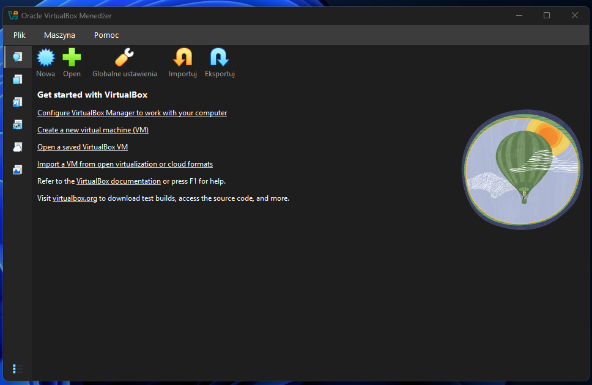

Domyślnie GUI VirtualBox ukrywa niektóre opcje, narzędzia i kreatory. Możesz wybrać ustawienia podstawowe lub zaawansowane. Kliknij **Plik → Globalne ustawienia...**

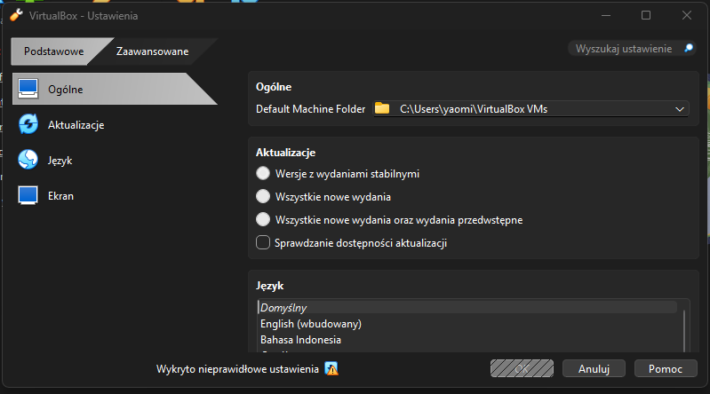

Proponuję wybrać tryb **Zaawansowane**. Tryb ten jest przeznaczony dla doświadczonych użytkowników, którzy chcą korzystać ze wszystkich funkcji VirtualBox (Tryb podstawowy jest dla osób preferujących prostszy interfejs).

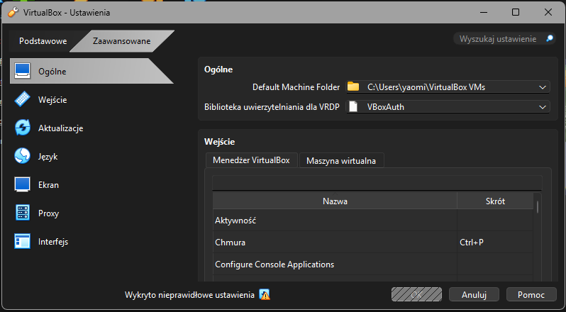

### Tworzenie maszyny wirtualnej na przykładzie systemu Windows Server
Klikamy na przycisk **Nowa** lub *Create a new virtual machine (VM)* – Utwórz nową maszynę wirtualną.

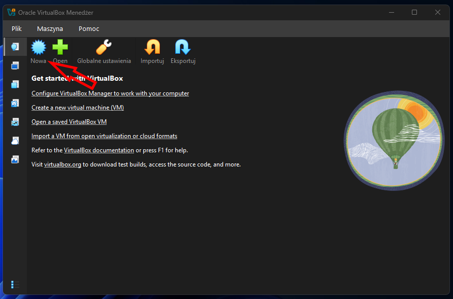

W pole **Nazwa** można wpisać dowolną nazwę maszyny wirtualnej. Jeżeli wpiszemy np. *Windows Serwer 2025* lub *Windows 11*, VirtualBox automatycznie wybierze nam typ systemu oraz jego wersję. Jeżeli nie wybierze, dobrym zwyczajem jest podać typ oraz wersję ręcznie (choć nie jest to bezwzględnie zobowiązujące).

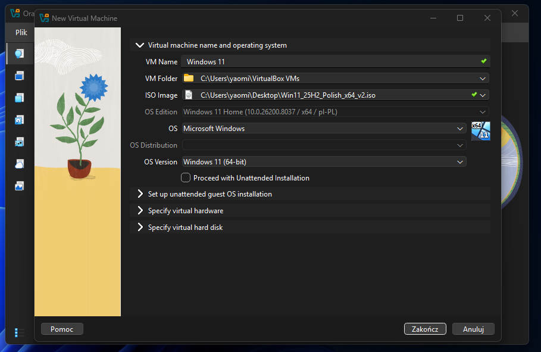

Kolejnym krokiem jest przydzielenie w zakładce **Specify virtual hardware** pamięci RAM. Powinno to być, dla wersji graficznej systemu, co najmniej zalecane minimum **2048 MB, czyli 2 GB oraz dwa rdzenie procesora**.

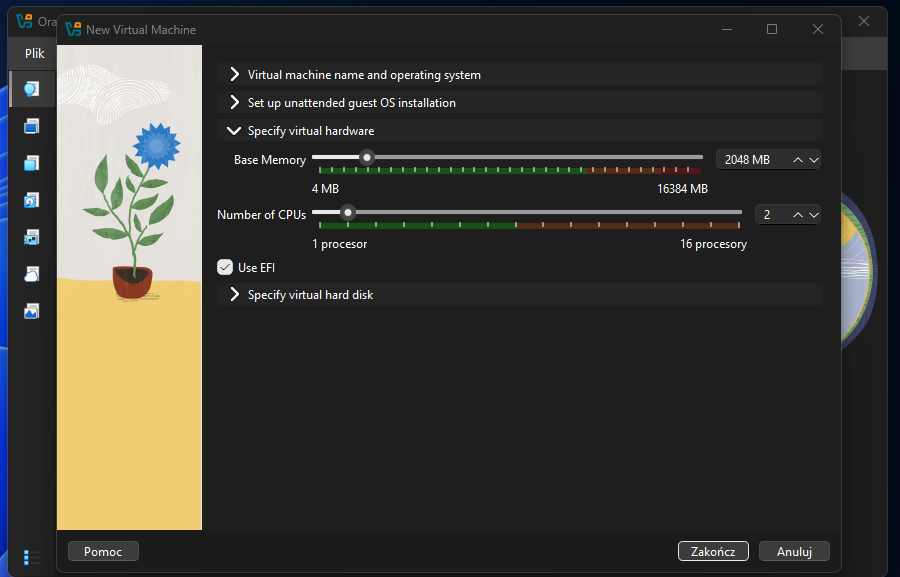

W zakładce **Specify virtual hard disk** utworzymy nowy wirtualny dysk twardy. Dysk ten nie jest dyskiem fizycznym, a jedynie plikiem (lub kilkoma) w naszym głównym systemie. Domyślnie VirtualBox zakłada utworzenie rozmiaru **50 GB** dla Windows Serwer 2025. Dyski wirtualne mają tę właściwość, że nie zajmują całej zadeklarowanej przestrzeni, a jedynie tyle, ile faktycznie wymaga system. Pozostawiamy domyślne ustawienia i klikamy w przycisk **Zakończ**.

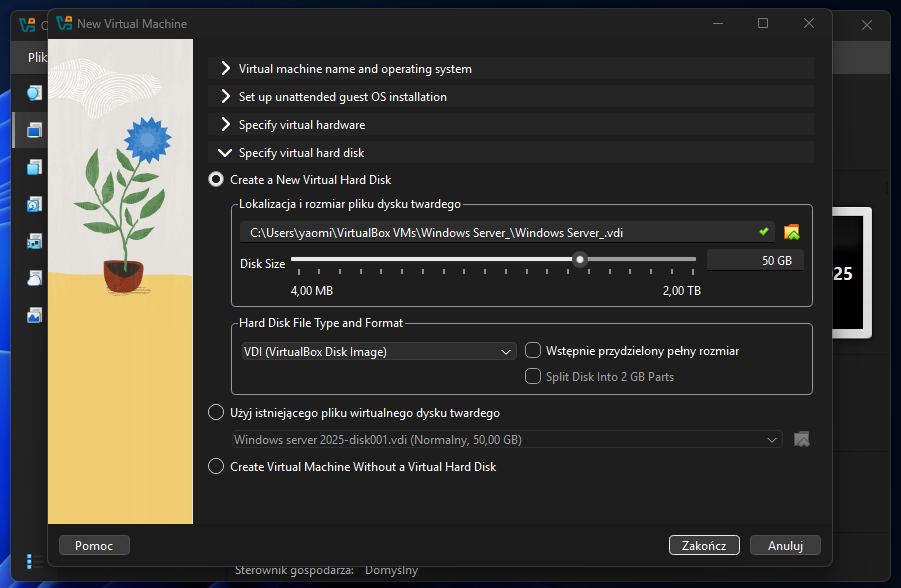

### Konfiguracja maszyny wirtualnej (Karty sieciowe)
Maszyna wirtualna została przygotowana pod nowy system. Dostępna jest na liście maszyn wirtualnych. Teraz należy ją skonfigurować. Zaznaczamy naszą maszynę i wybieramy przycisk **Ustawienia**.

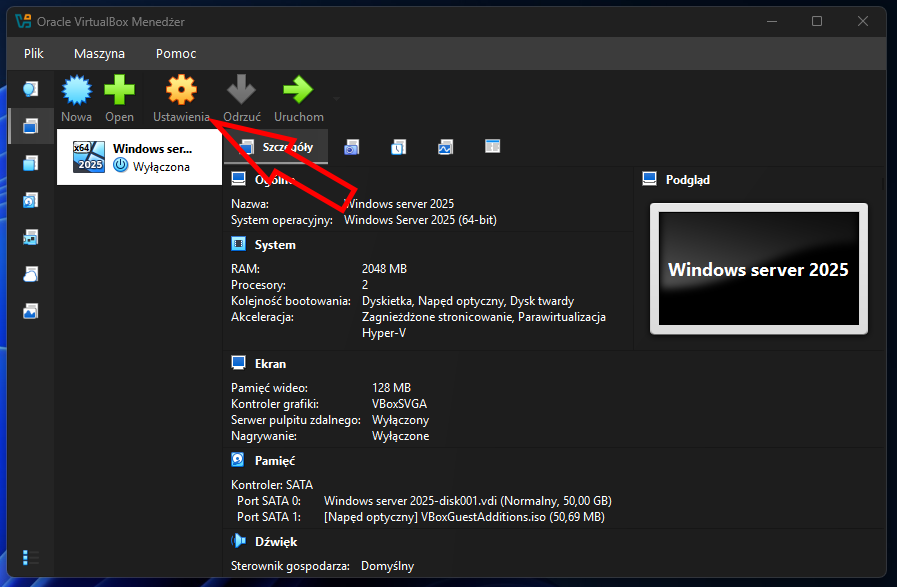

W zakładce **Sieć** pierwszy interfejs karty sieciowej (Karta 1) ustawiamy na opcję **NAT** lub **Mostkowana karta sieciowa (bridged)** po to, aby nasz serwer mógł świadczyć usługę routingu z dostępem do Internetu. Naciskamy OK.

Dodajemy drugą kartę sieciową (Karta 2) po to, aby nasz serwer tworzył wirtualne środowisko, do którego możemy podpiąć kilka maszyn wirtualnych oraz świadczyć routing. Drugi interfejs karty sieciowej ustawiamy na opcję **Sieć wewnętrzna**. Klikamy OK.

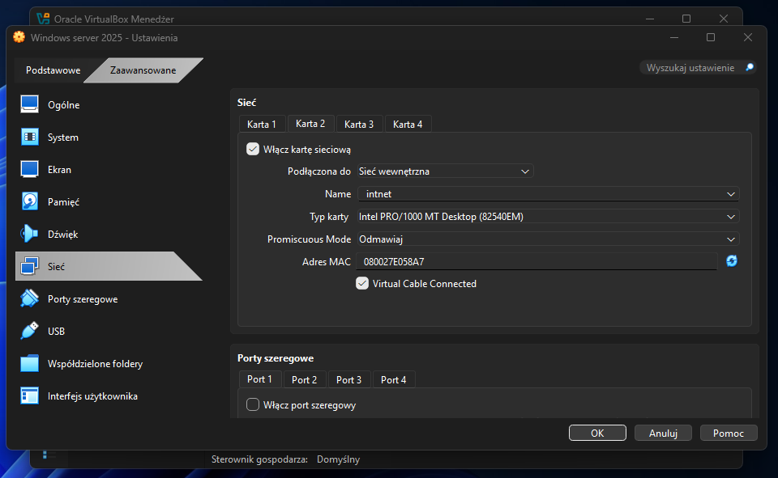

---

## 3. Usuwanie maszyny wirtualnej
Gdybyśmy z jakiegoś powodu chcieli usunąć maszynę wirtualną i utworzyć ją od początku, zaznaczamy maszynę przeznaczoną do usunięcia i klikamy w menu: **Maszyna → Usuń...**

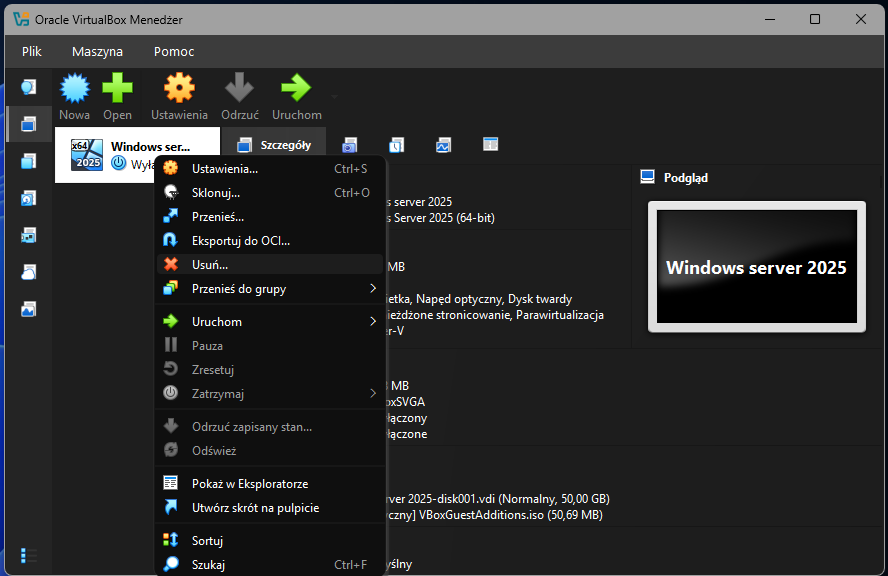

Zaznaczamy opcję **Usuń pliki maszyny wirtualnej i wirtualne dyski twarde** (Delete the virtual machine files and virtual hard disks), a następnie klikamy na przycisk **Usuń**.

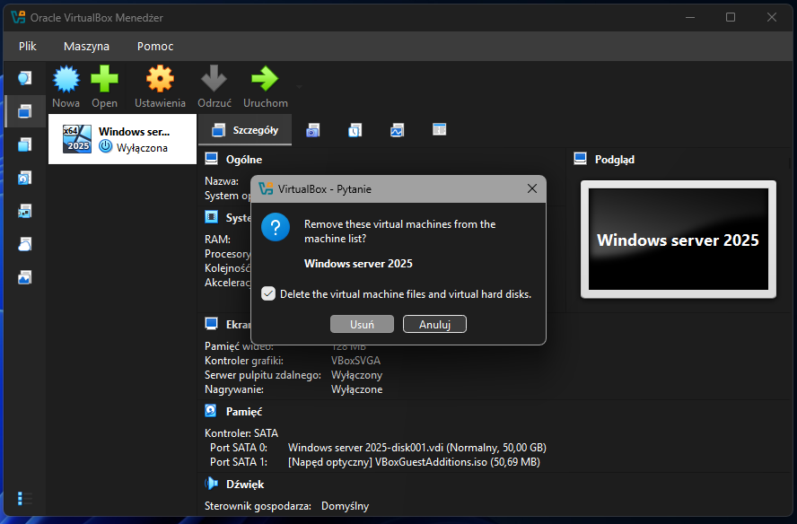
