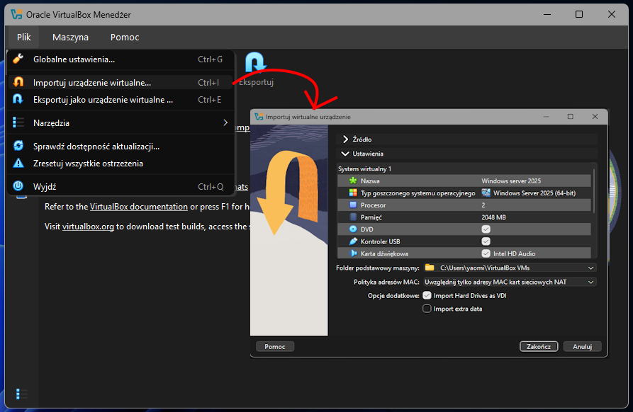
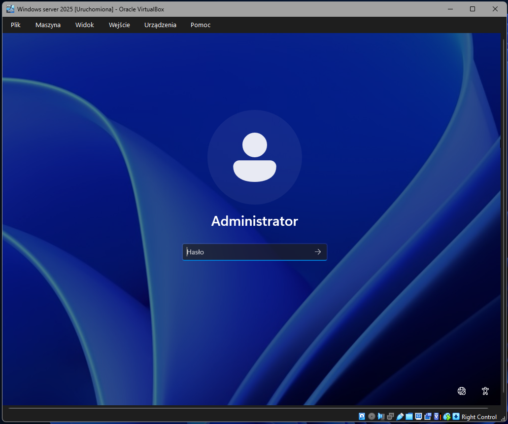
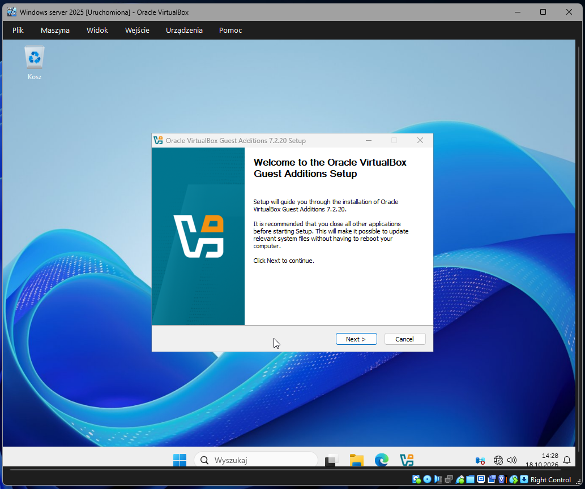

# Temat T03: Import maszyny wirtualnej Windows Server 2025 i instalacja dodatków

## 1. Cel ćwiczenia
* Zaimportowanie gotowej maszyny wirtualnej z systemem **Windows Server 2025** z pliku `.ova`.
* Uruchomienie maszyny i zalogowanie się do prekonfigurowanego systemu.
* Instalacja pakietu **VirtualBox Guest Additions** w celu poprawy wydajności i integracji z systemem gospodarza (m.in. obsługa pełnego ekranu).

## 2. Środowisko i wymagania wstępne
* Zainstalowane oprogramowanie Oracle VirtualBox.
* Plik `.ova` z systemem Windows Server 2025 pobrany z [dysku OneDrive/SharePoint](https://edulublin-my.sharepoint.com/personal/walstoc77_edu_lublin_eu/_layouts/15/onedrive.aspx?id=%2Fpersonal%2Fwalstoc77%5Fedu%5Flublin%5Feu%2FDocuments%2FWindows&ga=1).

---

## 3. Instrukcja krok po kroku

### Krok 1: Import maszyny wirtualnej w VirtualBox
1. Uruchom program Oracle VirtualBox.
2. Z górnego menu wybierz **Plik** (*File*) -> **Importuj urządzenie wirtualne...** (*Import Appliance...*).
3. W polu *Plik do importu* kliknij ikonę folderu i wskaż pobrany plik `.ova`.
4. Kliknij **Dalej** (*Next*), a w kolejnym oknie z ustawieniami urządzenia po prostu kliknij **Importuj** (*Import*). Poczekaj na zakończenie procesu.

### Krok 2: Uruchomienie i logowanie do systemu
1. Zaznacz zaimportowany serwer na liście w VirtualBoxie i kliknij **Uruchom**.
2. Maszyna włączy się i wyświetli ekran logowania.
3. Użyj skrótu klawiszowego, aby wywołać pole logowania (menu VirtualBoxa: *Wejście -> Klawiatura -> Naciśnij Ctrl-Alt-Del* lub skrót klawiszowy **Prawy Ctrl + Delete**).
4. Zaloguj się na wbudowane konto wpisując:
   * Użytkownik: **Administrator**
   * Hasło: `P@ssw0rd`

### Krok 3: Instalacja VirtualBox Guest Additions
Aby system działał płynnie i obsługiwał pełny ekran, należy zainstalować dodatki gościa.
1. Z górnego menu okna działającej maszyny wirtualnej wybierz **Urządzenia** -> **Zamontuj obraz płyty z dodatkami gościa...**.
2. W systemie Windows Server kliknij ikonę folderu (Eksplorator plików) na pasku zadań i przejdź do **Ten komputer**.
3. Kliknij prawym przyciskiem myszy na **Stację dysków CD (D:) VirtualBox Guest Additions** i wybierz **Zainstaluj lub uruchom program z nośnika**.
   *(Alternatywnie: otwórz dysk podwójnym kliknięciem i uruchom plik `VBoxWindowsAdditions-amd64.exe`)*.
4. Przeklikaj instalator, pozostawiając domyślne opcje (**Next** -> **Next** -> **Install**).
5. Jeśli pojawi się okno *Zabezpieczenia systemu Windows*, kliknij **Zainstaluj**.
6. Po zakończeniu instalacji zaznacz **Reboot now** i kliknij **Finish**. System zrestartuje się i będzie gotowy do pracy na pełnym ekranie.

