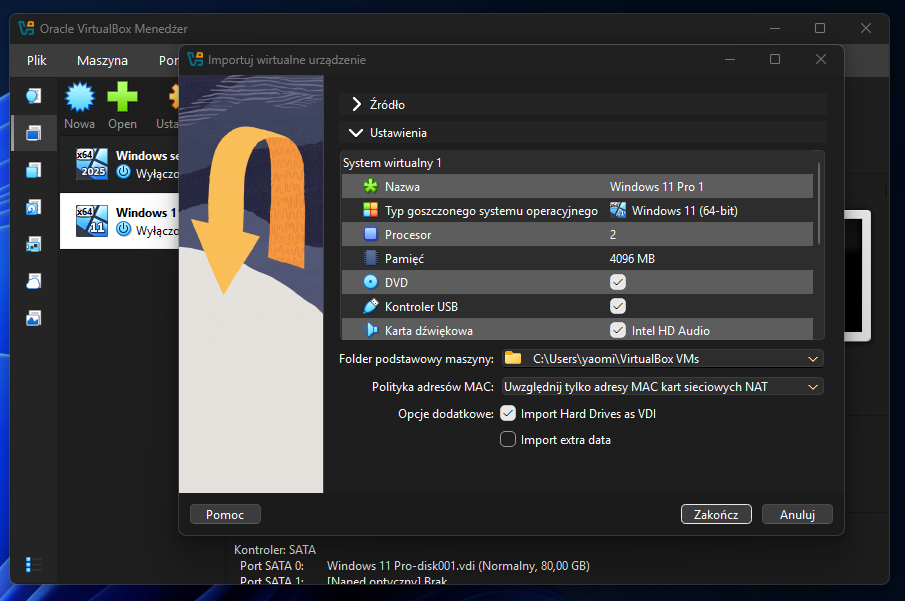
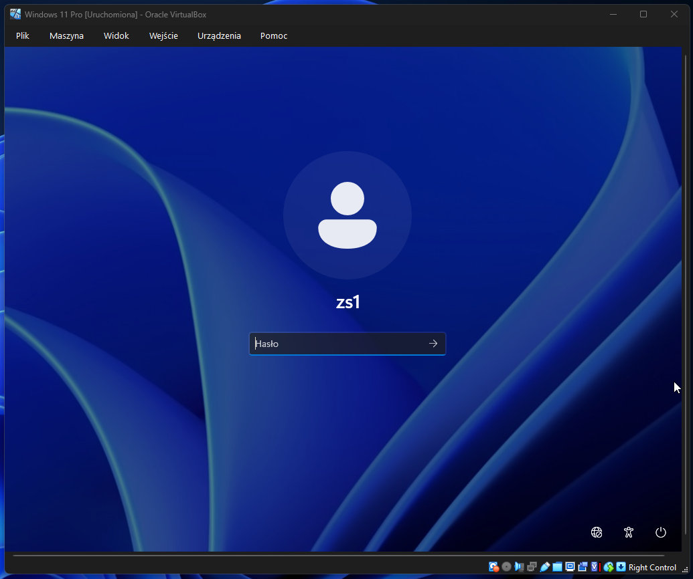
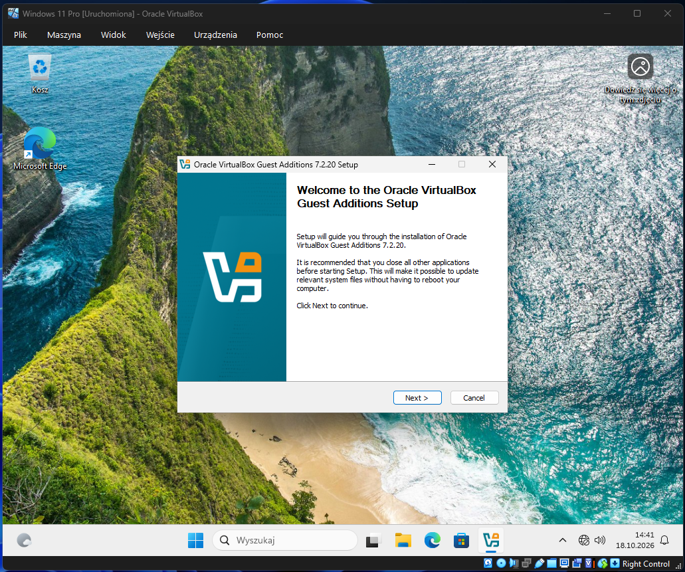

# Temat T04: Import maszyny wirtualnej Windows 11 i instalacja dodatków

## 1. Cel ćwiczenia
* Zaimportowanie gotowej maszyny wirtualnej z systemem **Windows 11** (stacja kliencka) z pliku `.ova`.
* Uruchomienie maszyny i zalogowanie się do prekonfigurowanego systemu roboczego.
* Instalacja pakietu **VirtualBox Guest Additions** w celu poprawy wydajności, płynności działania interfejsu oraz integracji z systemem gospodarza (obsługa pełnego ekranu).

## 2. Środowisko i wymagania wstępne
* Zainstalowane oprogramowanie Oracle VirtualBox.
* Plik `.ova` z systemem Windows 11 pobrany z [dysku OneDrive/SharePoint](https://edulublin-my.sharepoint.com/personal/walstoc77_edu_lublin_eu/_layouts/15/onedrive.aspx?id=%2Fpersonal%2Fwalstoc77%5Fedu%5Flublin%5Feu%2FDocuments%2FWindows&ga=1).

---

## 3. Instrukcja krok po kroku

### Krok 1: Import maszyny wirtualnej w VirtualBox
1. Uruchom program Oracle VirtualBox.
2. Z górnego menu wybierz **Plik** (*File*) -> **Importuj urządzenie wirtualne...** (*Import Appliance...*).
3. W polu *Plik do importu* kliknij ikonę folderu i wskaż pobrany plik `.ova` z systemem Windows 11.
4. Kliknij **Dalej** (*Next*), a w kolejnym oknie z ustawieniami urządzenia pozostaw domyślne opcje i kliknij **Importuj** (*Import*). 
5. Poczekaj na zakończenie procesu (może to potrwać kilka minut).

### Krok 2: Uruchomienie i logowanie do systemu
1. Zaznacz zaimportowaną maszynę klienta na liście w VirtualBoxie i kliknij **Uruchom**.
2. Maszyna włączy się i – ze względu na to, że jest to gotowy obraz – automatycznie załaduje ekran logowania.
3. Wywołaj ekran wpisywania hasła (jeśli to konieczne, użyj menu *Wejście -> Klawiatura -> Naciśnij Ctrl-Alt-Del* lub skrótu **Prawy Ctrl + Delete**).
4. Zaloguj się na wbudowane konto wpisując hasło: "P@ssw0rd".

### Krok 3: Instalacja VirtualBox Guest Additions
Aby stacja robocza działała płynnie i obsługiwała pełny ekran, należy doinstalować dodatki gościa.
1. Z górnego menu okna działającej maszyny wirtualnej wybierz **Urządzenia** -> **Zamontuj obraz płyty z dodatkami gościa...**.
2. W systemie Windows 11 otwórz **Eksplorator plików** (ikona folderu na pasku zadań) i przejdź do zakładki **Ten komputer**.
3. Zlokalizuj **Stację dysków CD (D:) VirtualBox Guest Additions**, kliknij na nią prawym przyciskiem myszy i wybierz **Zainstaluj lub uruchom program z nośnika** (lub po prostu otwórz dysk i uruchom plik `VBoxWindowsAdditions-amd64.exe`).
4. Przejdź przez instalator, pozostawiając domyślne opcje (**Next** -> **Next** -> **Install**).
5. Jeśli na ekranie pojawi się monit *Zabezpieczenia systemu Windows* z pytaniem o instalację oprogramowania urządzenia, kliknij **Zainstaluj**.
6. Po zakończeniu instalacji upewnij się, że zaznaczona jest opcja **Reboot now** i kliknij **Finish**. 
7. System Windows 11 zrestartuje się i po ponownym zalogowaniu będzie gotowy do pracy na pełnym ekranie.

---

## 4. Sprawdzenie wiedzy / Zadanie utrwalające
1. Sprawdź, czy po instalacji dodatków gościa i restarcie systemu rozdzielczość ekranu maszyny wirtualnej automatycznie dostosowuje się do rozmiaru okna programu VirtualBox (spróbuj zmienić rozmiar okna myszką).
