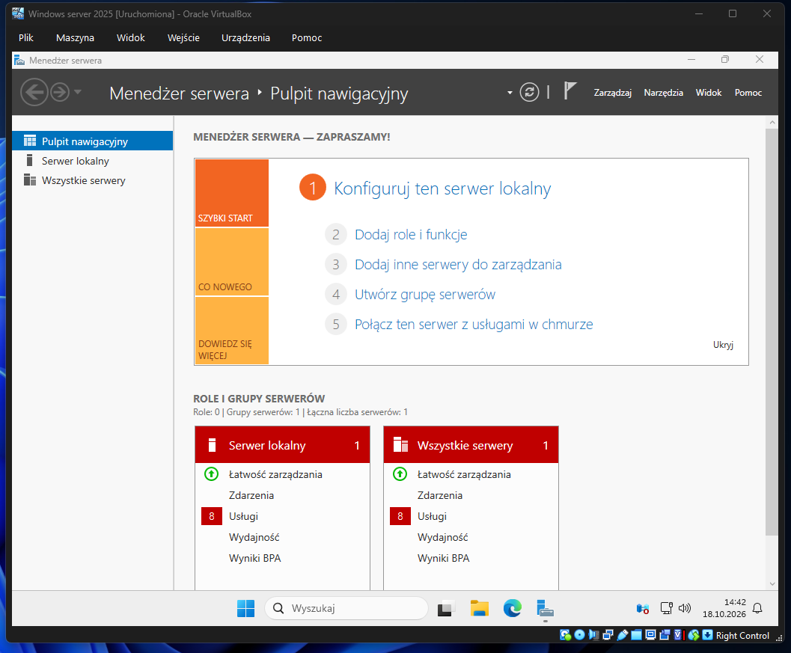
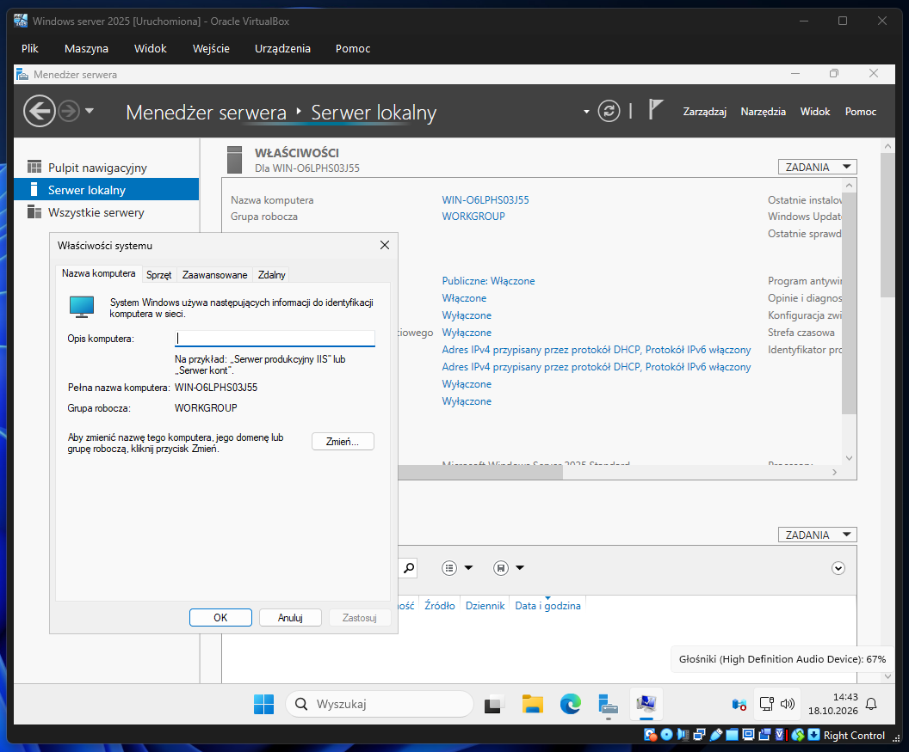
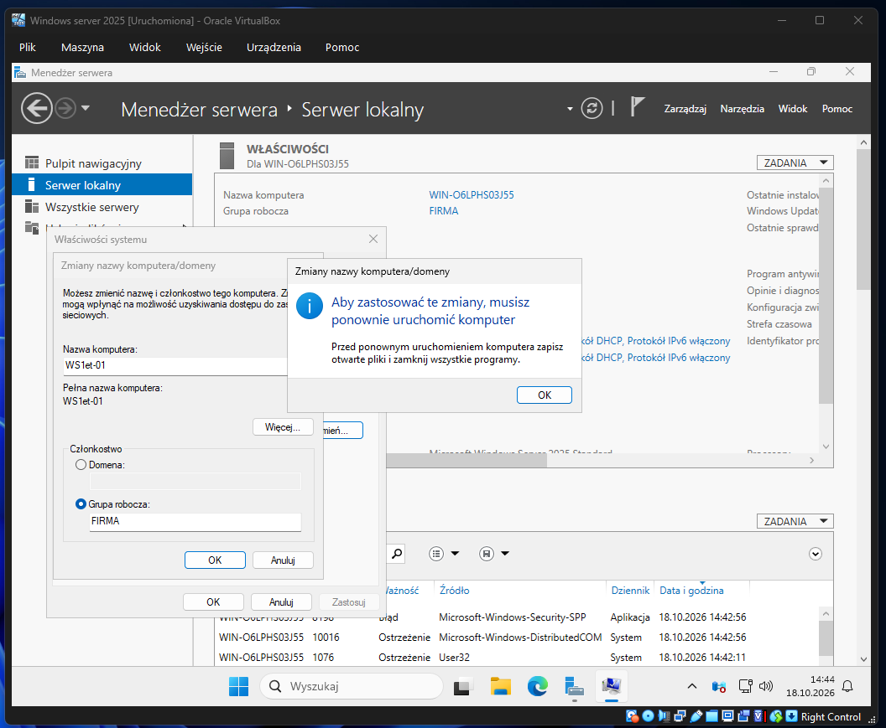
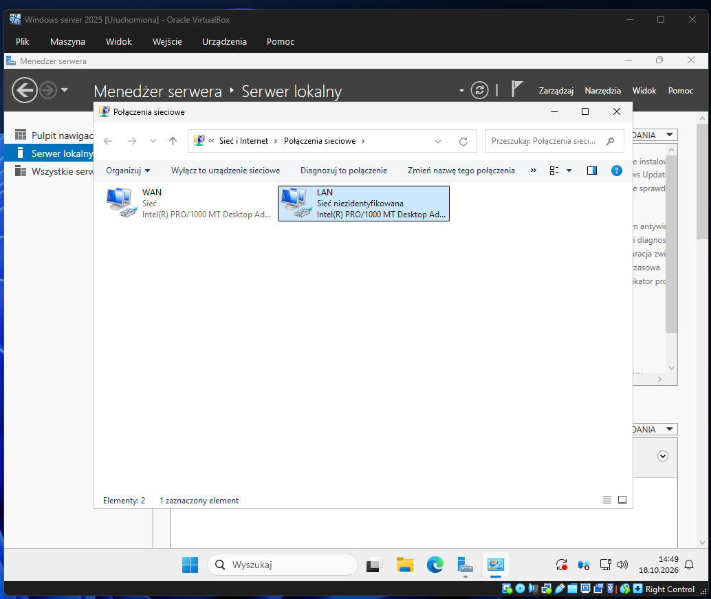

# Temat T05: Konfiguracja systemu po instalacji

## 1. Cel ćwiczenia
* Zapoznanie się z konsolą Menedżer Serwera (Server Manager).
* Wstępna konfiguracja serwera: zmiana nazwy komputera i dołączenie do grupy roboczej.
* Konfiguracja ustawień aktualizacji (Windows Update).
* Zmiana nazw interfejsów sieciowych dla łatwiejszej identyfikacji (WAN / LAN).
* Personalizacja pulpitu poprzez dodanie ikony *Ten komputer*.

---

## 2. Instrukcja krok po kroku

### Krok 1: Przegląd funkcji systemu Windows Serwer
Najważniejszym narzędziem w systemie Windows Server jest **Menedżer serwera**. Konsola ta otwiera się automatycznie po zalogowaniu. Jeśli tak się nie stało, otwórz menu Start i kliknij kafelek **Menedżer serwera**.

W sekcji **Serwer lokalny** masz możliwość konfiguracji kluczowych ustawień, takich jak nazwa komputera, grupa robocza, zapora, czy ustawienia sieci. Z kolei w sekcji **Wszystkie serwery** możesz monitorować i zarządzać innymi połączonymi maszynami.

### Krok 2: Zmiana nazwy komputera
1. W konsoli Menedżer Serwera przejdź do zakładki **Serwer lokalny**.
2. Kliknij obecną, losową nazwę w wierszu **Nazwa komputera**.
3. W oknie Właściwości systemu kliknij przycisk **Zmień...**.

4. Wpisz docelową nazwę serwera (np. `WS1et-01` (WS jako Windows Server, 1et jako klasa(xx) i 01 jako numer z dziennika(yy), wzór 'WSxx-yy') oraz ustal nazwę grupy roboczej (np. `FIRMA`).
5. Zatwierdź przyciskiem **OK**. System poinformuje o pomyślnym dołączeniu do grupy i poprosi o restart komputera. Kliknij **Uruchom ponownie teraz**.

### Krok 3: Konfiguracja usługi Windows Update
1. Po restarcie, w Menedżerze Serwera (`Serwer lokalny`) odszukaj pole **Windows Update**.
2. Jeśli widnieje obok status *Nigdy* lub *Pobierz tylko aktualizacje...*, kliknij w ten napis.
3. W oknie Ustawień kliknij **Sprawdź aktualizacje**.
4. Jeśli dostępne są niezbędne aktualizacje zabezpieczeń lub komponentów, system je pobierze i zainstaluje. Jeśli będzie wymagany restart, zrób to.

### Krok 4: Weryfikacja i zmiana nazw kart sieciowych
1. Wyłącz całkowicie maszynę wirtualną i przejdź do okna programu **VirtualBox**.
2. W ustawieniach maszyny (zakładka **Sieć**) upewnij się, że:
   * **Karta 1** ustawiona jest na **NAT**.
   * **Karta 2** ustawiona jest na **Sieć wewnętrzna** (o nazwie `intnet`).
3. Uruchom serwer ponownie.
4. W systemie, otwórz folder z połączeniami sieciowymi (możesz np. kliknąć skrót sieci w *Menedżerze serwera*). Zobaczysz interfejsy `Ethernet` oraz `Ethernet 2`.
5. Kliknij na nie prawym przyciskiem myszy, wybierz **Zmień nazwę** i nadaj im odpowiednio identyfikatory:
   * **WAN** (karta połączona przez NAT do internetu).
   * **LAN** (karta dla sieci wewnętrznej/laboratorium).

### Krok 5: Dodanie na pulpit ikony Ten komputer
Aby ułatwić zarządzanie plikami, warto wyciągnąć podstawowe ikony na pulpit.
1. Kliknij prawym przyciskiem myszy w pustym miejscu na Pulpicie i wybierz **Personalizuj**.
2. Z lewego menu wybierz **Kompozycje**.
3. Po prawej stronie okna (lub na dole, w sekcji *Powiązane ustawienia*) kliknij w link **Ustawienia ikon pulpitu**.
4. Zaznacz pole **Komputer** i zatwierdź klikając **Zastosuj** i **OK**.

