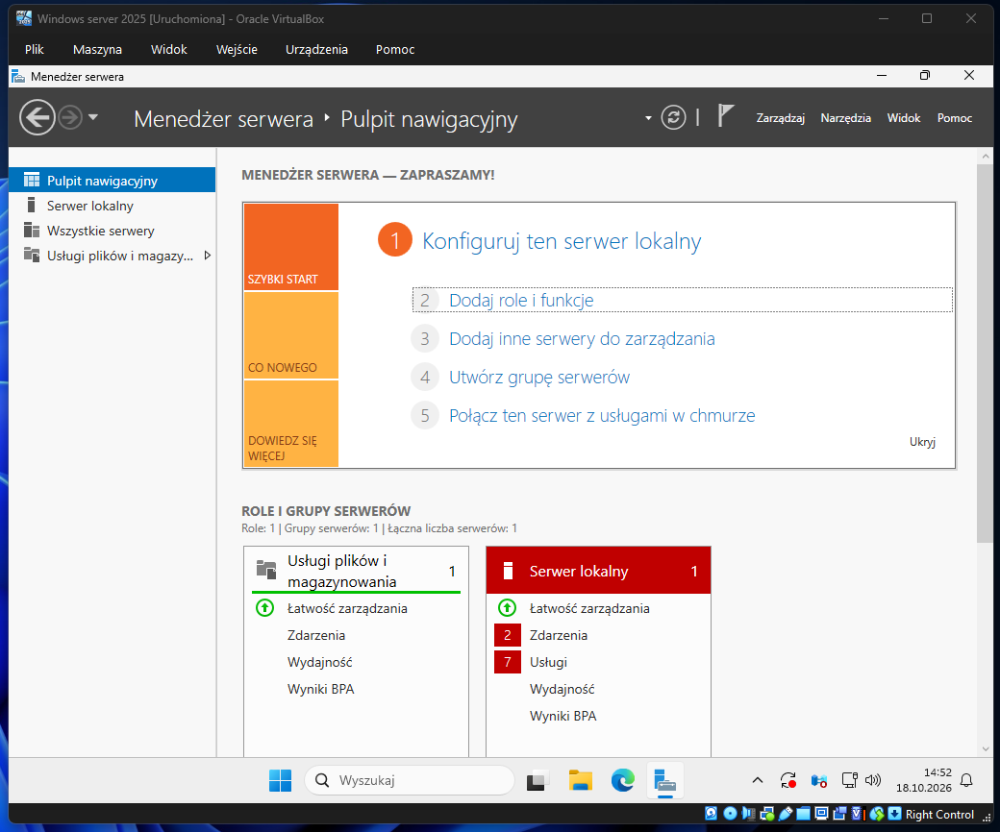
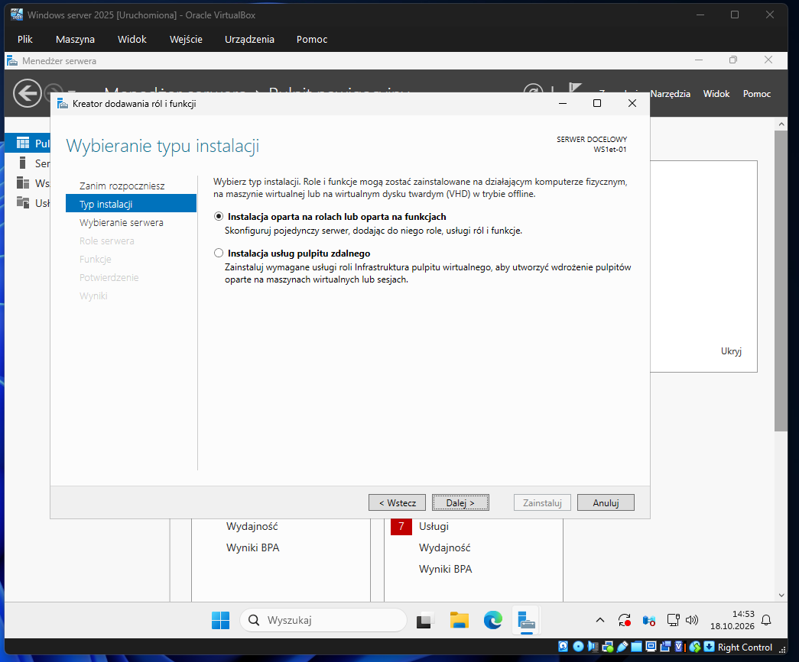
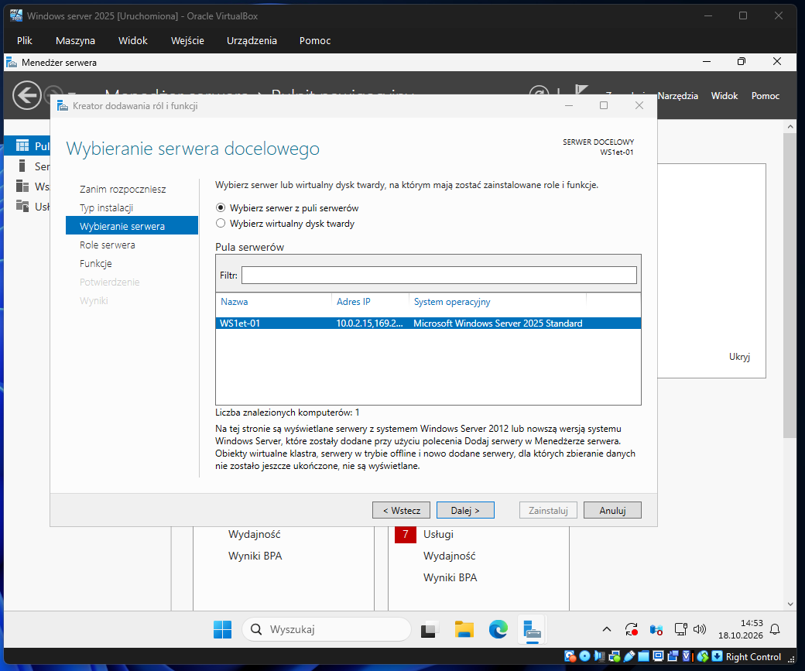
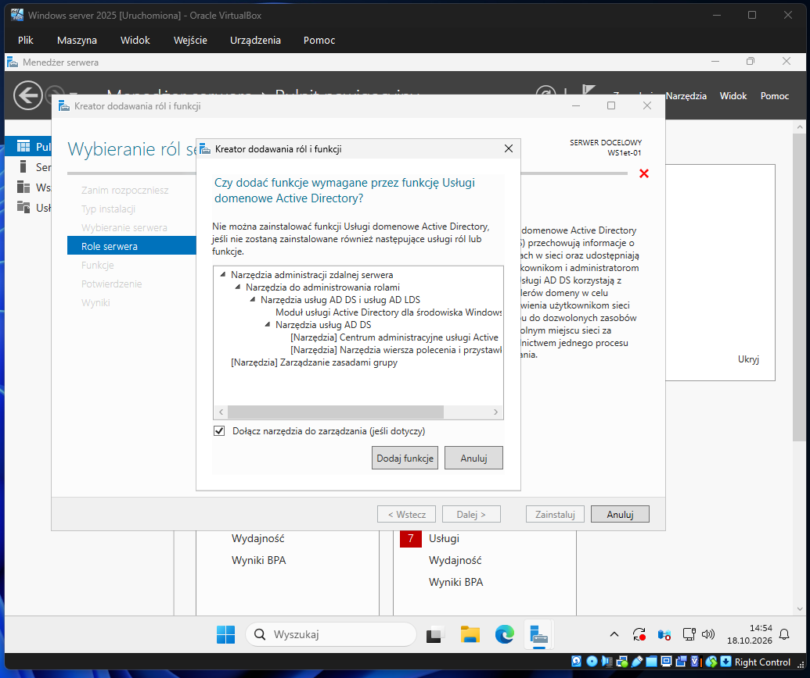
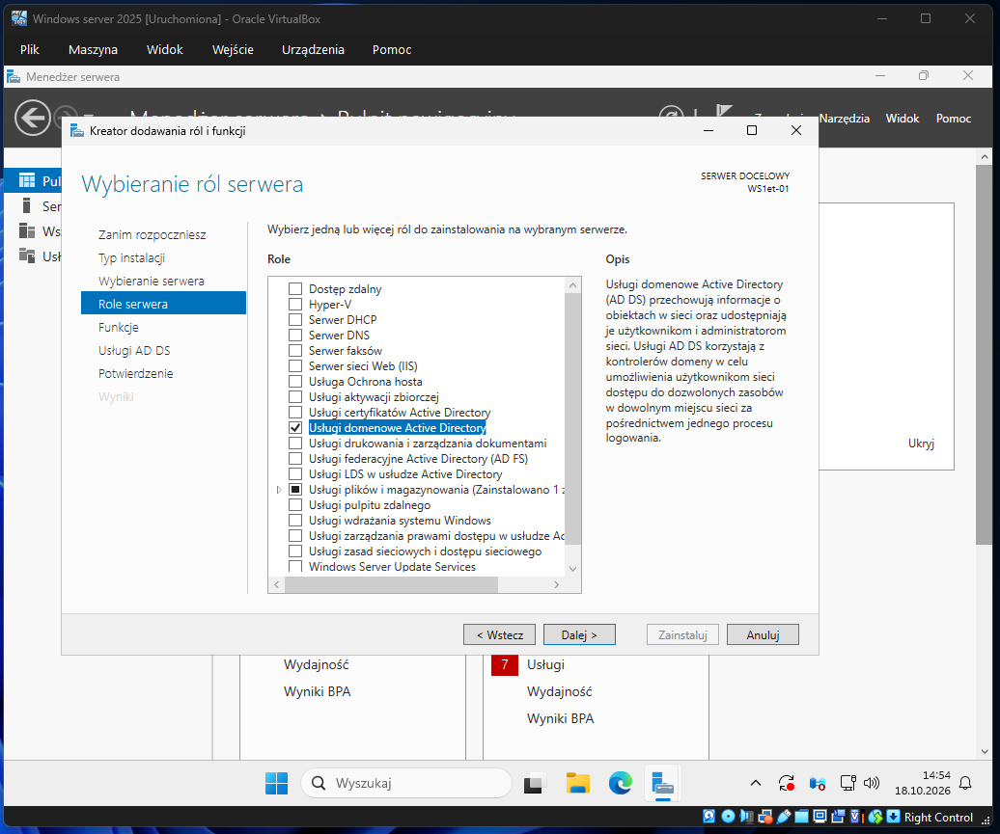
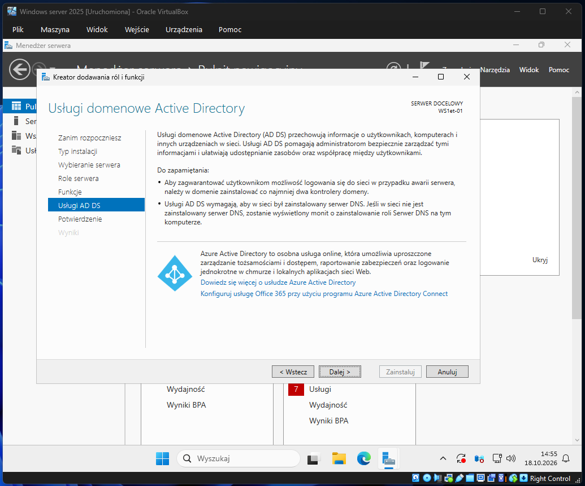
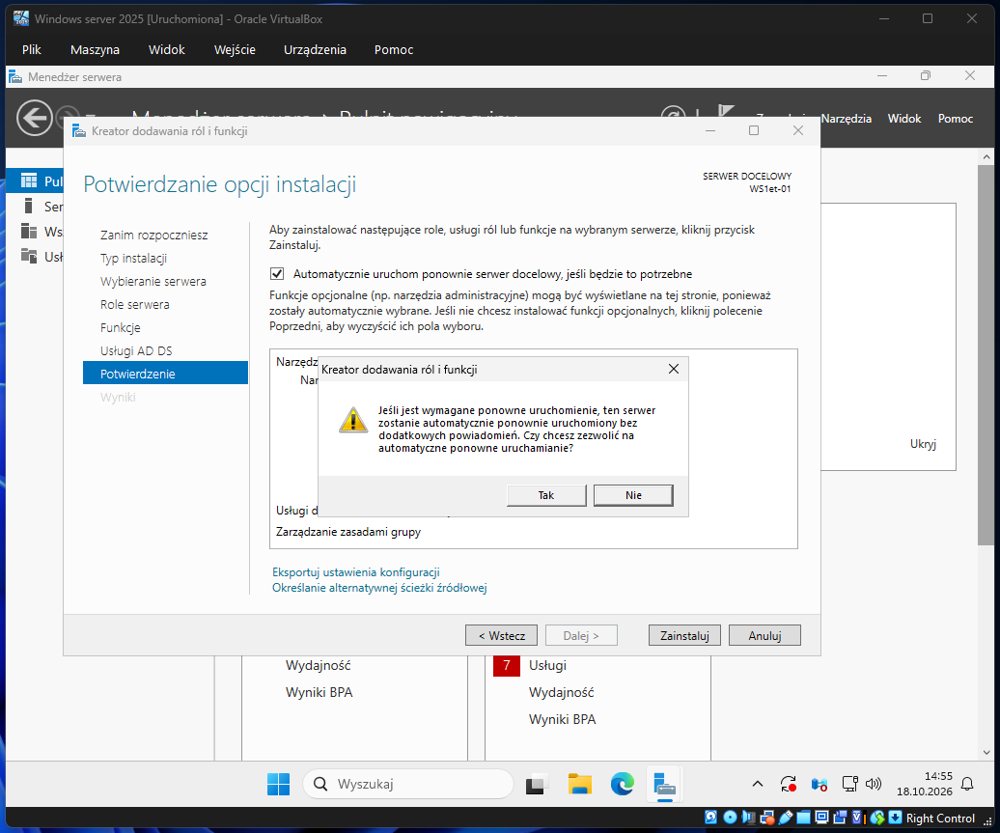
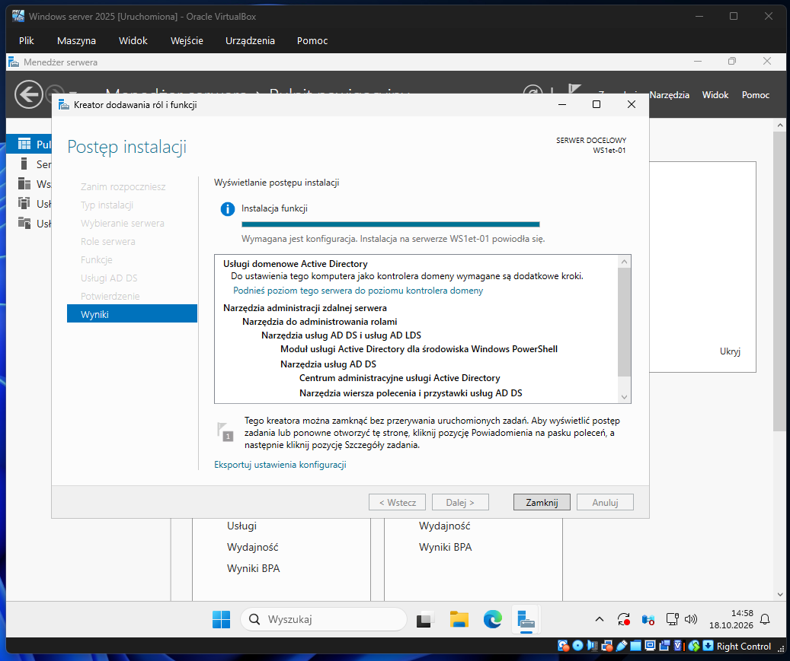

# Temat T06: Kontroler domeny - instalacja

## 1. Cel ćwiczenia
* Zrozumienie podstawowych pojęć związanych z usługami domenowymi (Active Directory, Kontroler domeny, LDAP, struktura AD).
* Instalacja roli **Usługi domenowe Active Directory (AD DS)** na systemie Windows Server 2025.

---

## 2. Wyjaśnienie pojęć
Przed przystąpieniem do konfiguracji, zapoznaj się z kluczowymi pojęciami:
* **Kontroler domeny:** Serwer z zainstalowanym Active Directory, przechowujący kopię magazynu danych.
* **Active Directory (AD):** Technologia Microsoft do zarządzania komputerami, użytkownikami i obiektami w sieci. Jest hierarchiczną bazą danych opartą na protokole LDAP.
* **LDAP (Lightweight Directory Access Protocol):** Protokół pozwalający na wymianę informacji z usługami katalogowymi przy użyciu TCP/IP.
* **Domena:** Obszar sieci z przypisanymi zasobami. Skupia obiekty AD (użytkowników, komputery). Wymaga przynajmniej jednego kontrolera.
* **AD DS:** Active Directory Domain Services (usługi domenowe Active Directory).
* **Struktura AD:**
  * **Liść:** Najmniejsza jednostka (np. użytkownik).
  * **Kontener:** Jednostka organizacyjna przechowująca liście.
  * **Domena:** Złożona z liści i kontenerów.
  * **Drzewo:** Domeny zorganizowane hierarchicznie.
  * **Las:** Składa się z jednego lub wielu drzew.

---

## 3. Instrukcja krok po kroku: Instalacja AD DS

Aby przekształcić system Windows Server w kontroler domeny, należy zainstalować odpowiednie role z poziomu Menedżera serwera.

### Krok 1: Uruchomienie kreatora
1. Otwórz konsolę **Menedżer serwera**.
2. Kliknij opcję **Dodaj role i funkcje** na Pulpicie nawigacyjnym (lub wybierz ją z górnego menu *Zarządzaj*).

### Krok 2: Konfiguracja typu instalacji i serwera
1. Na ekranie *Zanim rozpoczniesz* kliknij **Dalej**.
2. W oknie *Wybieranie typu instalacji* pozostaw domyślną opcję: **Instalacja oparta na rolach lub oparta na funkcjach** i kliknij **Dalej**.

3. W oknie *Wybieranie serwera docelowego* zaznacz swój serwer z puli (np. `WS1et-01`) i kliknij **Dalej**.

### Krok 3: Wybór ról serwera
1. Z listy ról zaznacz **Usługi domenowe Active Directory**.
2. Pojawi się dodatkowe okno z wymaganymi funkcjami administracyjnymi. Upewnij się, że opcja *Dołącz narzędzia do zarządzania* jest zaznaczona i kliknij **Dodaj funkcje**.

3. Zaznaczona rola AD DS powinna być teraz widoczna na liście. Kliknij **Dalej**.

### Krok 4: Funkcje i podsumowanie
1. Na karcie *Wybieranie funkcji* pozostaw domyślne ustawienia i kliknij **Dalej**.
2. Przeczytaj informacje na stronie z podsumowaniem działania usług AD DS i przejdź **Dalej**.

### Krok 5: Instalacja i weryfikacja
1. Na ekranie *Potwierdzanie opcji instalacji* zaznacz opcję **Automatycznie uruchom ponownie serwer docelowy, jeśli będzie to potrzebne**.
2. Potwierdź komunikat z ostrzeżeniem klikając **Tak**.
3. Kliknij przycisk **Zainstaluj**.

4. Rozpocznie się proces instalacji. Możesz kliknąć **Zamknij**, aby zwinąć okno kreatora. Postęp będzie widoczny w górnej części Menedżera serwera (pod ikoną flagi).
5. Po zakończeniu instalacji pod ikoną flagi pojawi się komunikat informujący, że instalacja się powiodła i konieczne jest podniesienie poziomu serwera do kontrolera domeny (co zrobimy w następnym ćwiczeniu).
6. Jeśli serwer nie uruchomił się ponownie automatycznie, wykonaj restart ręcznie.

