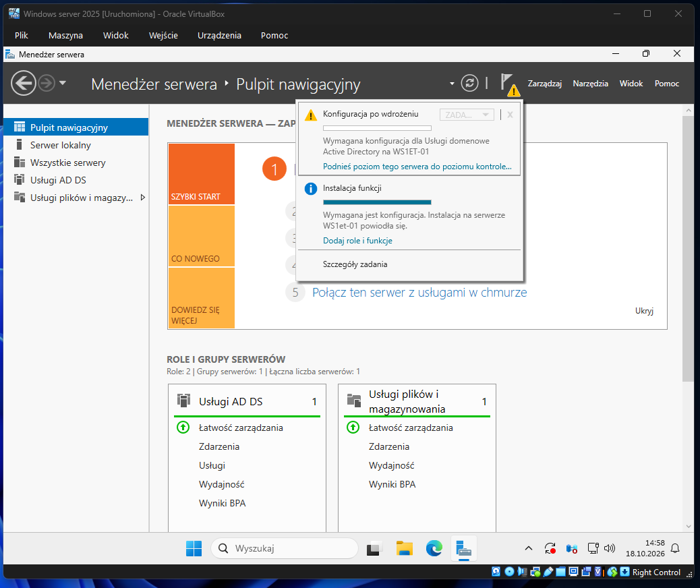
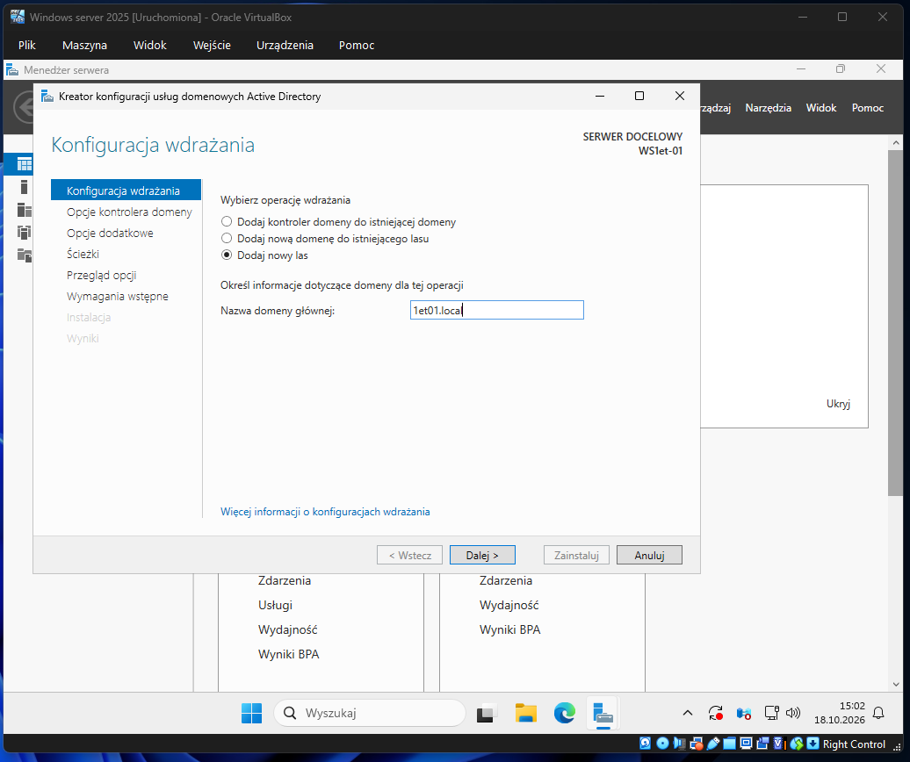
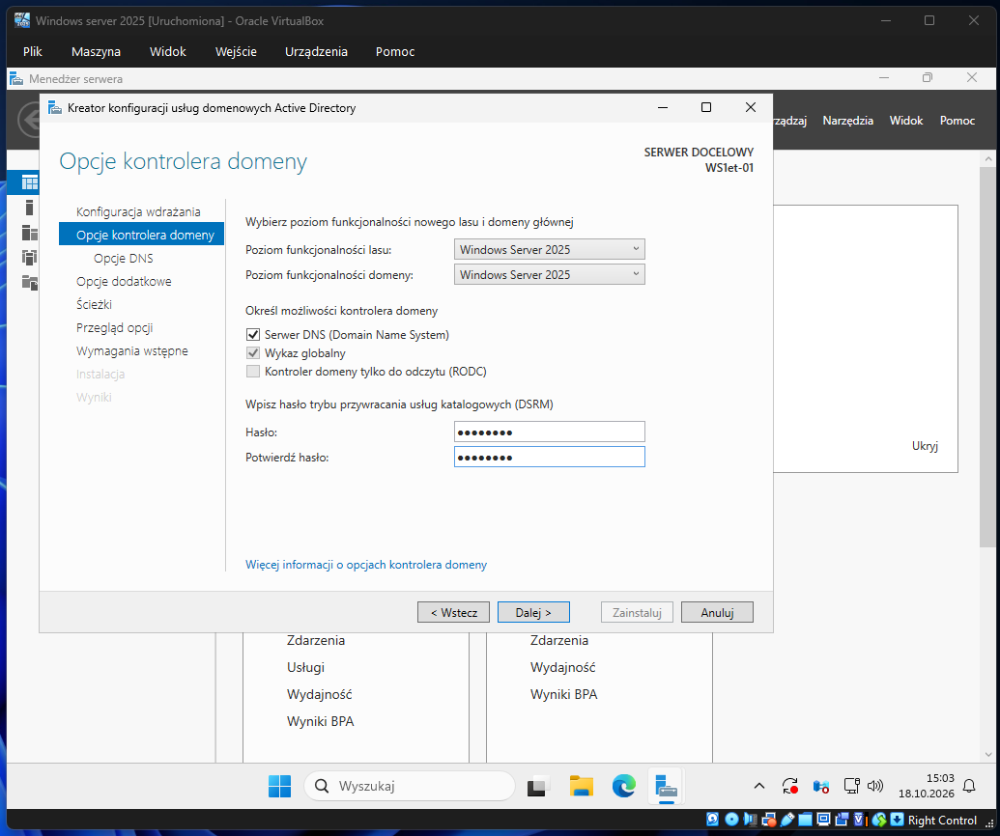
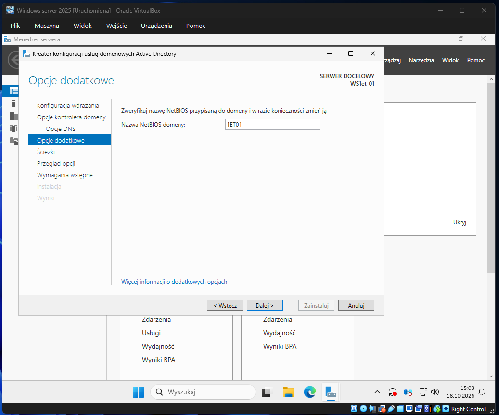
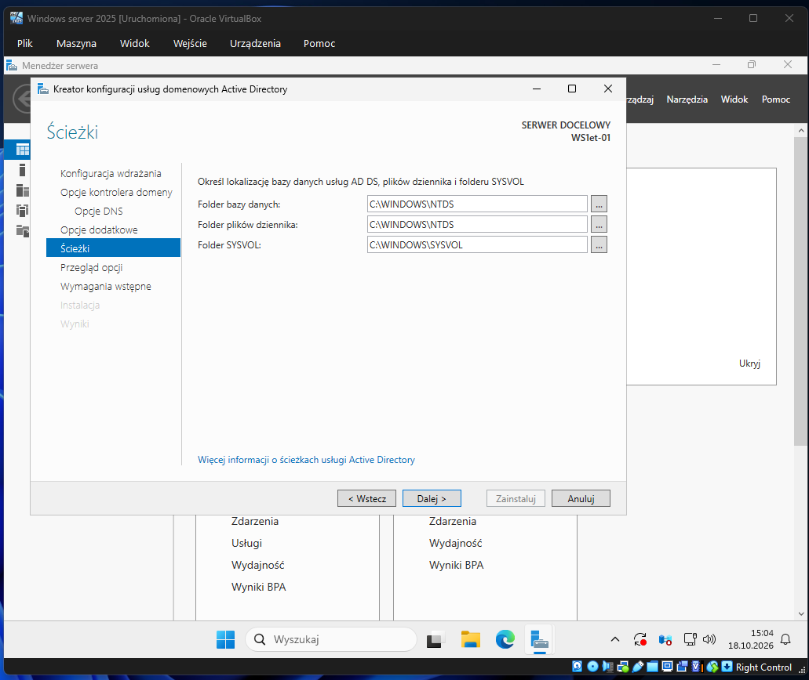
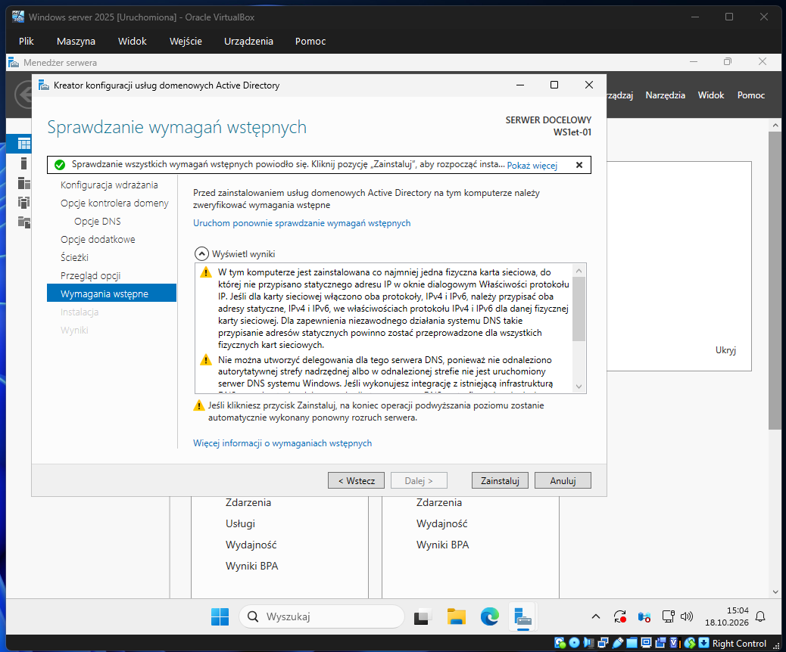
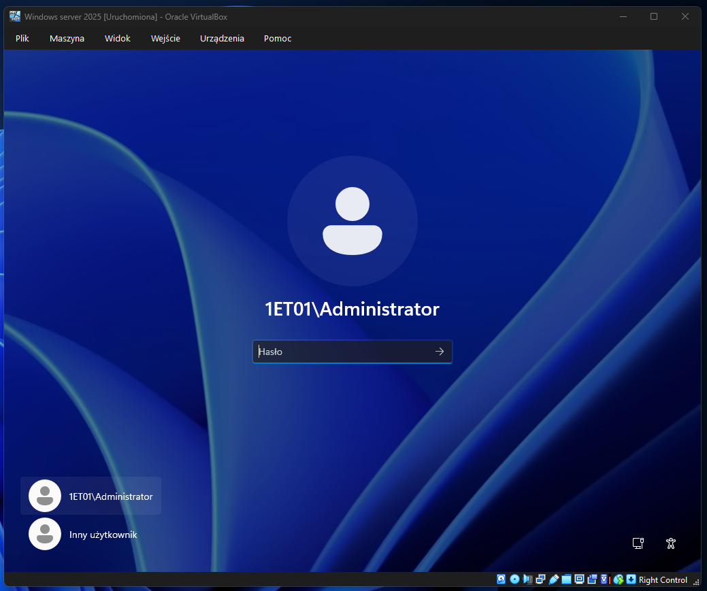

# Temat T07: Kontroler domeny - konfiguracja

## 1. Cel ćwiczenia
* Przeprowadzenie procesu promowania serwera z systemem Windows Server do roli **Kontrolera domeny**.
* Utworzenie nowego lasu Active Directory i konfiguracja domeny lokalnej (np. `xxyy.local` gdzie: xx – klasa, do której uczęszczasz, yy – to Twój numeru w dzienniku, local – domena lokalna (np.'1et01.local')).
* Weryfikacja poprawności instalacji po restarcie usług.

## 2. Środowisko i wymagania wstępne
* Maszyna wirtualna z zainstalowaną rolą **Usługi domenowe Active Directory (AD DS)** (zgodnie z instrukcją T06).
* Skonfigurowany statyczny adres IP na karcie sieciowej LAN (zgodnie z poprzednimi ćwiczeniami).

---

## 3. Instrukcja krok po kroku

### Krok 1: Uruchomienie kreatora konfiguracji AD DS
Po zainstalowaniu ról Menedżer serwera poinformuje o konieczności dokończenia konfiguracji. Możesz to zrobić na dwa sposoby:
* **Sposób 1:** Kliknij żółtą ikonę ostrzeżenia (flagę) na górnym pasku i wybierz **Podnieś poziom tego serwera do poziomu kontrolera domeny**.
* **Sposób 2:** W lewym menu kliknij **Usługi AD DS**, a następnie w głównej sekcji odszukaj żółty pasek z komunikatem i kliknij **Więcej...**, po czym wybierz **Podnieś poziom tego serwera...**.

> 💡 **Ważna uwaga (Rozwiązywanie problemów):** 
> Jeśli podczas próby uruchomienia kreatora lub na etapie "Konfiguracja wdrażania" napotkasz błąd pobierania danych (np. komunikat na czerwonym pasku: *„Żądanie wyświetlenia listy funkcji dostępnych na określonym serwerze nie powiodło się”*), kreator nie puści Cię dalej. W takiej sytuacji **najlepszym i najszybszym rozwiązaniem jest zrobienie restartu całej maszyny wirtualnej (reboot)**. Po ponownym uruchomieniu Menedżera serwera błąd powinien zniknąć.

### Krok 2: Konfiguracja wdrażania
1. W oknie kreatora wybierz operację: **Dodaj nowy las**.
2. W polu *Nazwa domeny głównej* wpisz nazwę w formacie `xxyy.local` (gdzie `xx` to nazwa Twojej klasy, a `yy` to Twój numer w dzienniku, np. `1et01.local`).
3. Kliknij **Dalej**.

### Krok 3: Opcje kontrolera domeny
1. Upewnij się, że poziom funkcjonalności lasu i domeny jest ustawiony poprawnie (np. na Windows Server 2016).
2. Sprawdź, czy zaznaczone są opcje **Serwer DNS** oraz **Wykaz globalny** (wymagane dla pierwszego kontrolera w lesie).
3. W sekcji hasła DSRM (Tryb przywracania usług katalogowych) wpisz silne hasło zgodnie z poleceniami prowadzącego (np. `P@ssw0rd`). 
4. Kliknij **Dalej**.

### Krok 4: Opcje DNS i Opcje dodatkowe
1. W oknie *Opcje DNS* zignoruj żółte ostrzeżenie o delegowaniu (jest to normalne, ponieważ na serwerze nie ma jeszcze nadrzędnej strefy DNS) i kliknij **Dalej**.
2. W oknie *Opcje dodatkowe* system automatycznie wygeneruje nazwę **NetBIOS** domeny (np. `1ET01`). Nie zmieniaj jej i kliknij **Dalej**.

### Krok 5: Ścieżki oraz Przegląd opcji
1. W oknie *Ścieżki* pozostaw domyślne lokalizacje dla bazy danych AD DS, plików dziennika oraz folderu `SYSVOL` (wszystkie w `C:\Windows\...`). Kliknij **Dalej**.
2. W oknie *Przegląd opcji* sprawdź podsumowanie konfiguracji i kliknij **Dalej**.

### Krok 6: Wymagania wstępne i instalacja
1. Kreator sprawdzi, czy serwer spełnia wszystkie wymogi. Jeśli na górze pojawi się zielony znacznik informujący o pomyślnym sprawdzeniu, kliknij **Zainstaluj**.
2. Rozpocznie się proces konfiguracji usług katalogowych.
3. **Uwaga:** Po zakończeniu instalacji serwer zostanie automatycznie uruchomiony ponownie. Nie przerywaj tego procesu.

### Krok 7: Weryfikacja po restarcie
1. Po ponownym uruchomieniu maszyny zwróć uwagę na ekran logowania. Zamiast samego konta Administratora, powinieneś zobaczyć prefiks z nazwą domeny NetBIOS (np. `1ET01\Administrator`).
2. Zaloguj się używając ustalonego wcześniej hasła (np. `P@ssw0rd`).
3. Otwórz Menedżer serwera i w lewym panelu sprawdź obecność zakładek: **AD DS** oraz **DNS**. Świadczy to o poprawnym skonfigurowaniu kontrolera domeny.

Usługi domenowe Active Directory zostały skonfigurowane.
