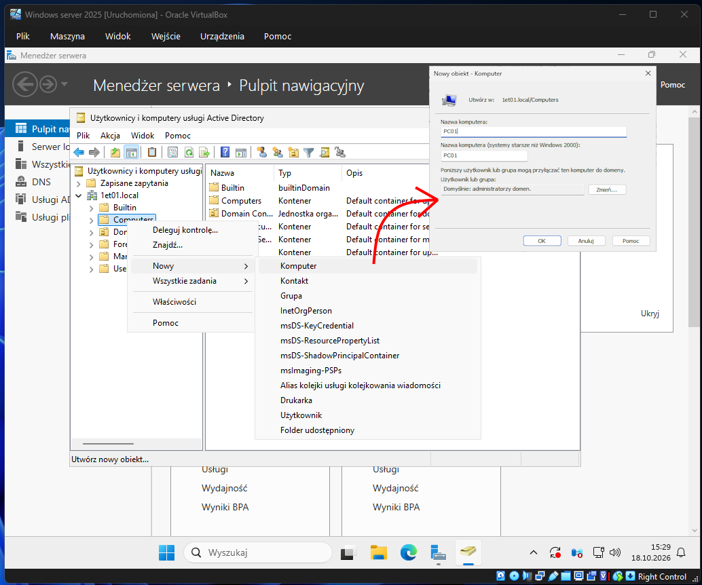
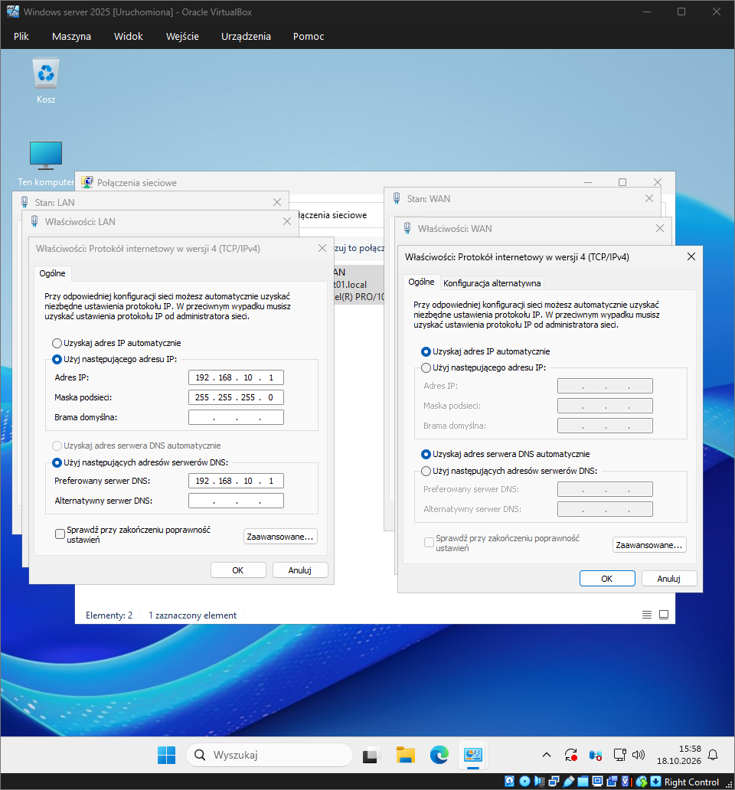
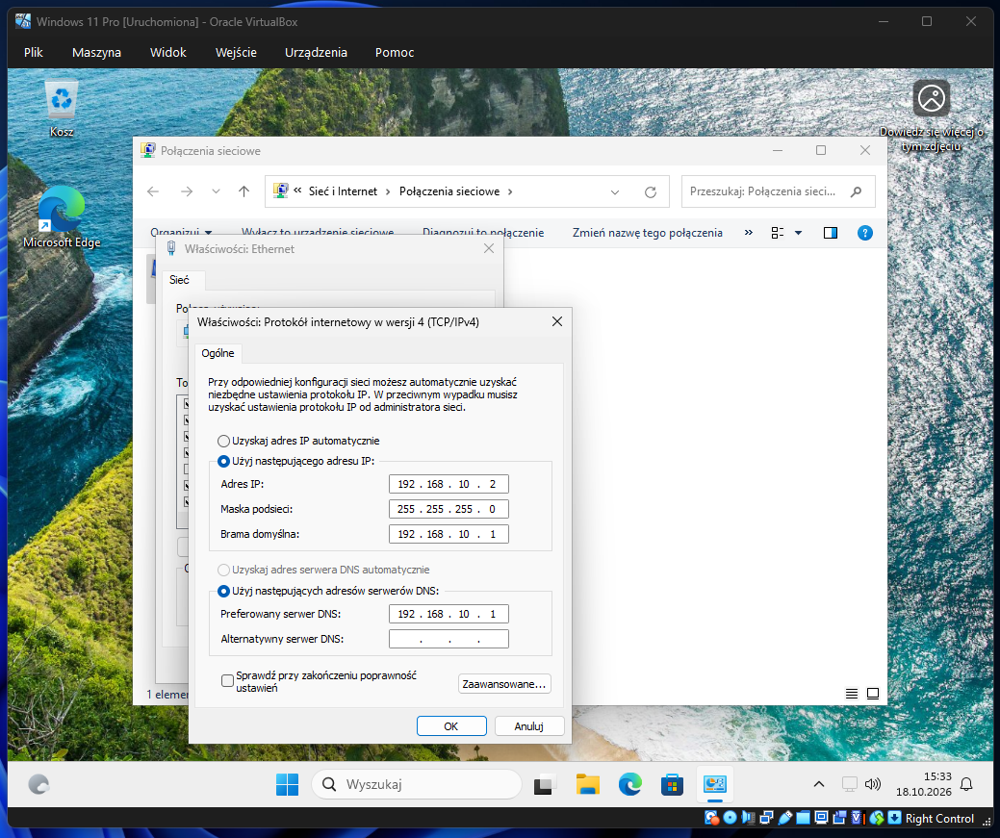

# Temat T08: Tworzenie konta komputera w usłudze AD DS i konfiguracja sieci

## 1. Cel ćwiczenia
* Utworzenie konta komputera klienckiego w domenie za pomocą usługi Active Directory.
* Konfiguracja i weryfikacja statycznych adresów IP na interfejsach serwera i klienta.
* Diagnozowanie połączenia sieciowego za pomocą polecenia `ping`.
* Konfiguracja zapory sieciowej (Windows Defender Firewall) w celu zezwolenia na ruch ICMP (żądania echa).

## 2. Środowisko i wymagania wstępne
* Skonfigurowany kontroler domeny Windows Server 2025.
* Maszyna wirtualna z systemem klienckim (w naszym przypadku Windows 11).
* Obie maszyny muszą być podłączone do tej samej sieci wewnętrznej (`Internal Network`).

---

## 3. Instrukcja krok po kroku

### Krok 1: Tworzenie konta komputera w AD DS
Aby stacja kliencka mogła dołączyć do domeny, dobrym zwyczajem jest wcześniejsze utworzenie jej konta w strukturze Active Directory.
1. Na serwerze otwórz **Menedżer serwera**.
2. W prawym górnym rogu kliknij **Narzędzia** -> **Użytkownicy i komputery usługi Active Directory**.
3. Rozwiń drzewo swojej domeny (np. `1et01.local`) i znajdź kontener **Computers**.
4. Kliknij prawym przyciskiem myszy na kontener **Computers** i wybierz **Nowy** -> **Komputer**.
5. Wpisz nazwę przypisaną dla klienta (np. `PC01`).
6. Domyślnie grupa `Administratorzy domen` ma uprawnienia do podłączania komputera. Nie zmieniaj tego i kliknij **OK**.

### Krok 2: Ustawienie adresacji IP na serwerze i kliencie
Aby maszyny mogły się komunikować, muszą znajdować się w tej samej podsieci i posiadać poprawne adresy.
Najszybszy sposób na otwarcie konfiguracji sieci to użycie skrótu klawiszowego **Win + R**, wpisanie `ncpa.cpl` i zatwierdzenie **Enter**.
Po jej otwarciu klikamy 2 razy w daną kartę sieciową, a potem zaznaczenie opcji "Protokół internetowy w wersji 4 (TCP/IPv4)" i naciśnięcie przycisku "Właściwości"

1. Na **Serwerze** upewnij się, że interfejs **LAN** (ten w sieci wewnętrznej) ma ustawiony statyczny adres IP i preferowany serwer DNS na '192.168.10.1' i maskę podsieci na 255.255.255.0, a interfejs **WAN** (NAT) pobiera IP automatycznie.

3. Przejdź na maszynę z **Windows 11 (Klient)**.
4. Otwórz konfigurację sieci (`ncpa.cpl`), wybierz kartę sieciową i wejdź w jej **Właściwości**.
5. Zaznacz **Protokół internetowy w wersji 4 (TCP/IPv4)** i kliknij **Właściwości**.
6. Wprowadź ustawienia statyczne, aby pasowały do podsieci serwera:
   * **Adres IP:** `192.168.10.2`
   * **Maska podsieci:** `255.255.255.0`
   * **Brama domyślna:** `192.168.10.1` (IP serwera)
   * **Preferowany serwer DNS:** `192.168.10.1` (IP serwera, kluczowe do rozwiązania nazwy domeny)
7. Kliknij **OK** i zamknij okna konfiguracyjne.

### Krok 3: Test połączenia (Ping) i konfiguracja zapory sieciowej
Przetestujemy teraz, czy maszyny widzą się nawzajem.
1. Na serwerze otwórz wiersz poleceń (`cmd`) i wykonaj test na adres IP klienta: "ping 192.168.10.2"
2. Jeśli otrzymujesz komunikat Upłynął limit czasu żądania (Request timed out), oznacza to, że fizyczne połączenie działa, ale zapora systemu Windows na komputerze klienckim blokuje pakiety ICMP.
3. Przejdź na komputer kliencki (Windows 11).
4. Użyj skrótu Win + R, wpisz wf.msc i naciśnij Enter. Otworzy się Zapora Windows Defender z zabezpieczeniami zaawansowanymi.
5. W lewym panelu kliknij Reguły przychodzące.
6. Odszukaj na liście regułę o nazwie: "Udostępnianie plików i drukarek (żądanie echa — ruch przychodzący ICMPv4)" (Może być ich kilka, dla profili domena/prywatny/publiczny).
7. Zaznacz je, kliknij prawym przyciskiem myszy i wybierz Włącz regułę. Z ikon zniknie "szary znaczek" i staną się zielone.
8. Poczekaj chwilę na zastosowanie zmian
9. Wróć na serwer i ponów polecenie ping 192.168.10.2. Powinieneś teraz otrzymać odpowiedź z podanym czasem (np. time<1ms).
