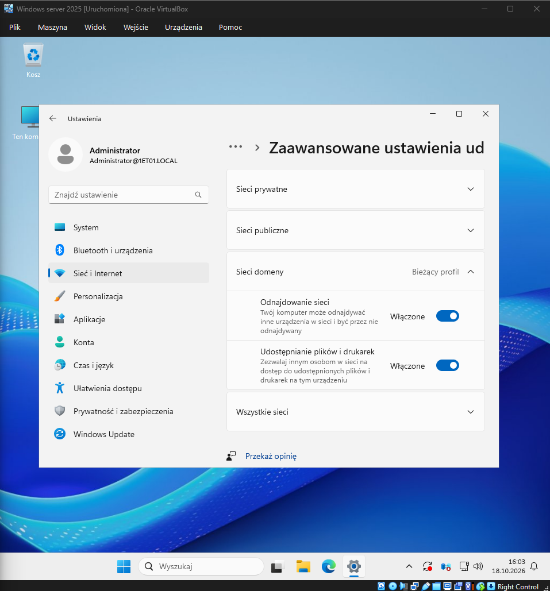
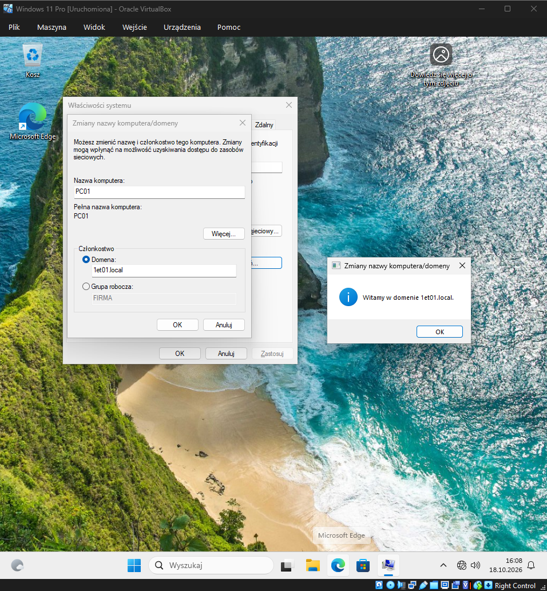
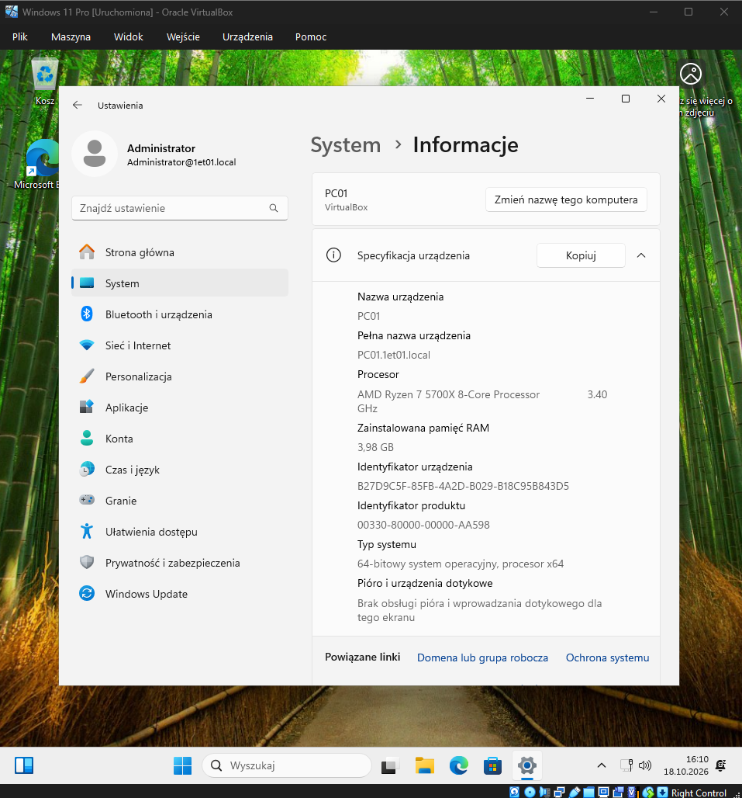
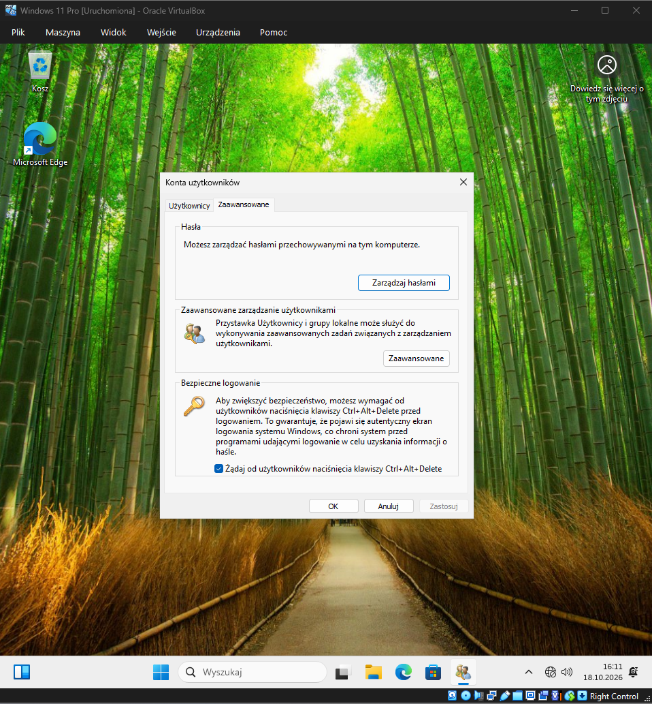

# Temat T09: Przyłączanie systemu klienta do domeny

## 1. Cel ćwiczenia
* Włączenie odnajdowania sieci oraz udostępniania plików i drukarek na serwerze i kliencie.
* Zmiana nazwy stacji roboczej klienta i przyłączenie jej do domeny Active Directory.
* Weryfikacja przynależności komputera do domeny oraz konfiguracja bezpiecznego logowania (Ctrl+Alt+Delete).

## 2. Środowisko i wymagania wstępne
* Skonfigurowany serwer z uruchomioną rolą Kontrolera Domeny (zgodnie z poprzednimi ćwiczeniami).
* Skonfigurowana sieć wewnętrzna oraz utworzone konto komputera w AD DS.

---

## 3. Instrukcja krok po kroku

### Krok 1: Włączenie odnajdowania sieci
Odnajdywanie sieci pozwala urządzeniom na wzajemne wykrywanie się. Wykonaj te kroki na obu maszynach (Serwerze i Kliencie):
1. Otwórz menu Start i wejdź w **Ustawienia**.
2. Wybierz **Sieć i Internet**, a następnie w sekcji *Status* kliknij **Opcje udostępniania**.
3. Rozwiń profil **Domena (obecny profil)**.
4. Zaznacz opcje:
   * **Włącz odnajdowanie sieci**
   * **Włącz udostępnianie plików i drukarek**
5. Kliknij **Zapisz zmiany**.
6. Sprawdź ponownie, czy odnajdowanie sieci zostało włączone. Jeśli zmiany nie są
jednak zapisywane, to należy sprawdzić, czy uruchomiono następujące usługi
zależności:

• Klient DNS
• Publikacja zasobu odnajdywania funkcji
• Odnajdywanie SSDP (Usługa odnajdowania SSDP)
• Host urządzenia UPnP

7. W oknie wyszukiwania wpisz usługi i kliknij
znalezioną aplikację.
Inny sposób: wciśnij na klawiaturze klawisz
Windows + R. W oknie aplikacji
Uruchamianie wpisz polecenie
services.msc i naciśnij Enter
8. Odszukaj usługę Publikacja zasobu odnajdywania funkcji, kliknij na jej
nazwę prawym przyciskiem myszy i wybierz Właściwości.
9. W sekcji Typ uruchamiania ustaw opcję Automatyczny, następnie kliknij kolejno
Uruchom → Zastosuj → OK
10. Sprawdź pozostałe trzy usługi i jeśli jest to konieczne, wykonaj wyżej opisane
czynności. Teraz ponownie Włącz odnajdowanie sieci jak pokazano wyżej

> **Rozwiązywanie problemów (jeśli odnajdowanie nie chce się włączyć):**
> Naciśnij `Win + R`, wpisz `services.msc`. Upewnij się, że następujące usługi są uruchomione, a ich *Typ uruchomienia* to **Automatyczny**:
> * Klient DNS
> * Publikacja zasobu odnajdywania funkcji
> * Odnajdywanie SSDP
> * Host urządzenia UPnP

### Krok 2: Przyłączanie klienta do domeny
Czynności te wykonujemy na maszynie klienckiej (Windows 11):
1. Naciśnij klawisze `Win + R`, wpisz polecenie `sysdm.cpl` i naciśnij Enter, aby otworzyć Właściwości systemu.
2. W zakładce *Nazwa komputera* kliknij przycisk **Zmień...**.

3. Zmień nazwę komputera na taką, jaką utworzyłeś wcześniej w AD DS (np. `PC01`).
4. W sekcji *Członkostwo* zaznacz **Domena** i wpisz nazwę domeny (np. `1et01.local`).
5. Kliknij **OK**.
6. System poprosi o podanie poświadczeń uprawniających do przyłączenia. Wpisz nazwę konta (np. `Administrator`) i hasło administratora domeny (np. `P@ssw0rd`).

7. Powinien pojawić się komunikat "Witamy w domenie...". Kliknij **OK** we wszystkich oknach i uruchom ponownie komputer klienta poprzez naciśnięcie przycisku "Uruchom ponownie teraz"

### Krok 3: Logowanie i weryfikacja
1. Po restarcie na ekranie logowania wybierz opcję **Inny użytkownik**.
2. Wpisz prefiks domeny i nazwę użytkownika (np. `1ET01\Administrator`) oraz hasło.
3. Aby sprawdzić poprawność przyłączenia, przejdź do **Ustawienia -> System -> Informacje**. W sekcji *Pełna nazwa urządzenia* powinien widnieć człon domenowy (np. `PC01.1et01.local`).

### Krok 4: Wymuszenie bezpiecznego logowania (Ctrl+Alt+Delete)
Aby zapobiec działaniu złośliwych programów udających ekran logowania, włączymy obowiązek używania skrótu bezpiecznego logowania na kliencie.
1. Naciśnij `Win + R`, wpisz `netplwiz` i wciśnij Enter.
2. Przejdź do zakładki **Zaawansowane**.
3. W sekcji *Bezpieczne logowanie* zaznacz pole **Żądaj od użytkowników naciśnięcia klawiszy Ctrl+Alt+Delete**.
4. Kliknij **Zastosuj** i **OK**.
5. Po wylogowaniu zobaczymy ekran z informacją o konieczności naciśnięcia klawiszy Ctrl + Alt + Delete.

