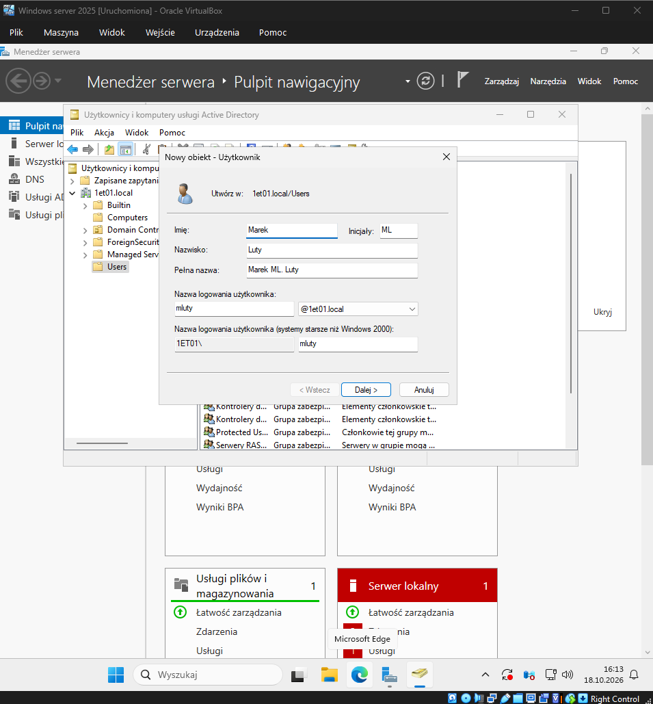
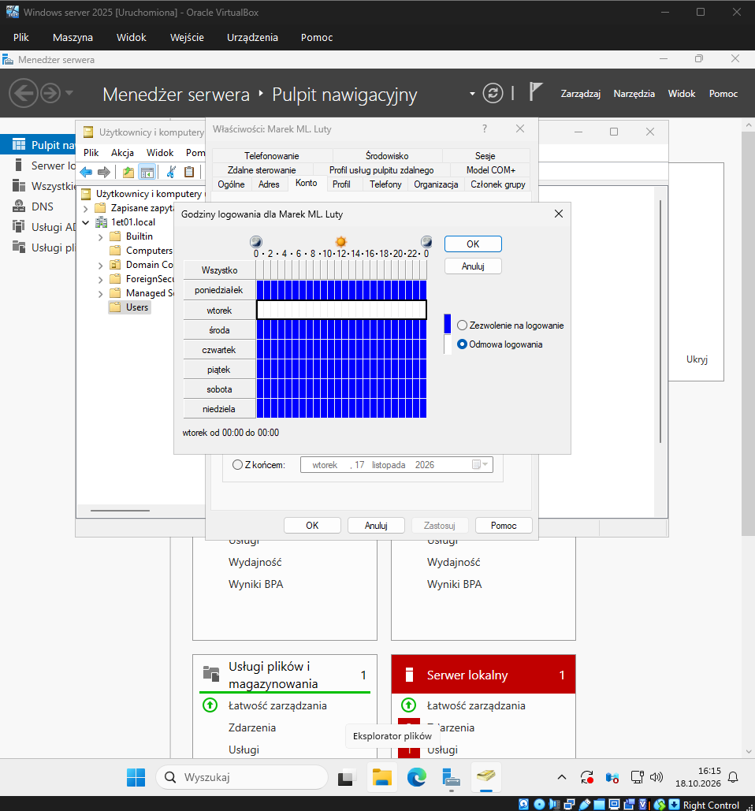

# Temat T10: Zarządzanie domenowymi kontami użytkowników

## 1. Cel ćwiczenia
* Zrozumienie różnicy między użytkownikami lokalnymi a domenowymi.
* Tworzenie i modyfikacja kont użytkowników za pomocą interfejsu graficznego i wiersza poleceń.
* Tworzenie i zarządzanie jednostkami organizacyjnymi (OU).
* Wykonywanie operacji na obiektach Active Directory przy użyciu konsoli PowerShell (`dsadd`, `dsrm`, `dsmove`).

## 2. Środowisko i wymagania wstępne
* Skonfigurowany i uruchomiony serwer pełniący rolę kontrolera domeny (np. Windows Server 2025 z zainstalowanymi usługami AD DS).

---

## 3. Instrukcja krok po kroku

### Część A: Zarządzanie z użyciem interfejsu graficznego (GUI)

#### Krok 1: Tworzenie nowego użytkownika domenowego
1. Z górnego menu **Menedżera serwera** wybierz **Narzędzia** -> **Użytkownicy i komputery usługi Active Directory** (alternatywnie `Win + R` -> `dsa.msc`).
2. Rozwiń drzewo swojej domeny (np. `1et01.local`).
3. Zaznacz kontener **Users**, kliknij go prawym przyciskiem myszy i wybierz **Nowy** -> **Użytkownik**.
4. Wypełnij podstawowe dane (Imię, Nazwisko, Inicjały) oraz określ **Nazwę logowania użytkownika** (np. `mluty`). Kliknij **Dalej**.
5. Wpisz silne hasło (np. `zaq1@WSX`). W celach edukacyjnych możesz odznaczyć *Użytkownik musi zmienić hasło...* i zaznaczyć *Hasło nigdy nie wygasa*.
6. Kliknij **Dalej**, sprawdź podsumowanie i wybierz **Zakończ**.



#### Krok 2: Modyfikacja właściwości konta
1. Znajdź nowo utworzonego użytkownika w kontenerze **Users**.
2. Kliknij na niego prawym przyciskiem myszy i wybierz **Właściwości**.
3. Przejdź na zakładkę **Konto**.
4. Sprawdź opcje godzin logowania klikając **Godziny logowania...** (możesz np. zablokować logowanie we wtorki, zaznaczając obszar na niebiesko i klikając *Odmowa logowania*).
5. Klikając **Zaloguj do...** możesz ograniczyć maszyny, do których użytkownik ma dostęp, podając nazwę komputera (np. `PC01`).



#### Krok 3: Tworzenie i przenoszenie Jednostek Organizacyjnych (OU)
Jednostki organizacyjne to kontenery pozwalające zachować porządek w AD.
1. Prawym przyciskiem myszy kliknij nazwę swojej domeny i wybierz **Nowy** -> **Jednostka organizacyjna**.
2. Nazwij ją, np. `Sala` i zatwierdź. Następnie utwórz drugą o nazwie `Pracownia`.
3. Aby przenieść jednostkę `Sala` do wnętrza `Pracownia`, zaznacz `Sala`, kliknij PPM i wybierz **Przenieś...**, a następnie wskaż `Pracownia`.
   * **Uwaga:** Jeśli system odmówi dostępu, przejdź do górnego menu **Widok** -> zaznacz **Opcje zaawansowane**. Następnie wejdź we **Właściwości** obiektu `Sala`, otwórz zakładkę **Obiekt** i **odznacz** opcję *Chroń obiekt przed przypadkowym usunięciem*. 


---

### Część B: Zarządzanie z użyciem wiersza poleceń (PowerShell)

#### Krok 4: Narzędzia "DS" w terminalu
Uruchom konsolę **PowerShell** jako administrator. Poznasz przydatne narzędzia z rodziny `ds`:
* `dsadd` (dodawanie obiektów)
* `dsrm` (usuwanie obiektów)
* `dsmove` (przenoszenie obiektów)

#### Krok 5: Tworzenie kont z poziomu PowerShell
Użyjemy polecenia `dsadd user`, aby stworzyć konto dla Piotra Kani. Skopiuj lub przepisz poniższe polecenie:
```powershell
dsadd user "CN=Piotr PK. Kania, CN=Users, DC=1et01, DC=local" -ln Kania -fn Piotr -upn pkania -pwd zaq1@WSX -disabled no
```
Zwróć uwagę, aby fragmenty DC odpowiadały nazwie Twojej domeny (np. DC=1et01, DC=local).

#### Krok 6: Tworzenie jednostki organizacyjnej z poziomu PowerShell
Dodaj nową jednostkę o nazwie Informatycy:
```powershell
dsadd ou "OU=Informatycy, DC=1et01, DC=local"
```
#### Krok 7: Przenoszenie obiektów za pomocą poleceń
Przenieś nowo utworzonego użytkownika z domyślnego kontenera Users do utworzonej wcześniej jednostki Pracownia:
```powershell
dsmove "CN=Piotr PK. Kania, CN=Users, DC=1et01, DC=local" -newparent "OU=Pracownia, DC=1et01, DC=local"
```
#### Krok 8: Usuwanie obiektów z poziomu PowerShell
Gdy obiekt nie jest już potrzebny, skasuj go, używając dsrm. Usuńmy wcześniej utworzoną jednostkę Informatycy:
```powershell
dsrm "OU=Informatycy, DC=1et01, DC=local"
```
Wpisz y, aby potwierdzić czynność.
