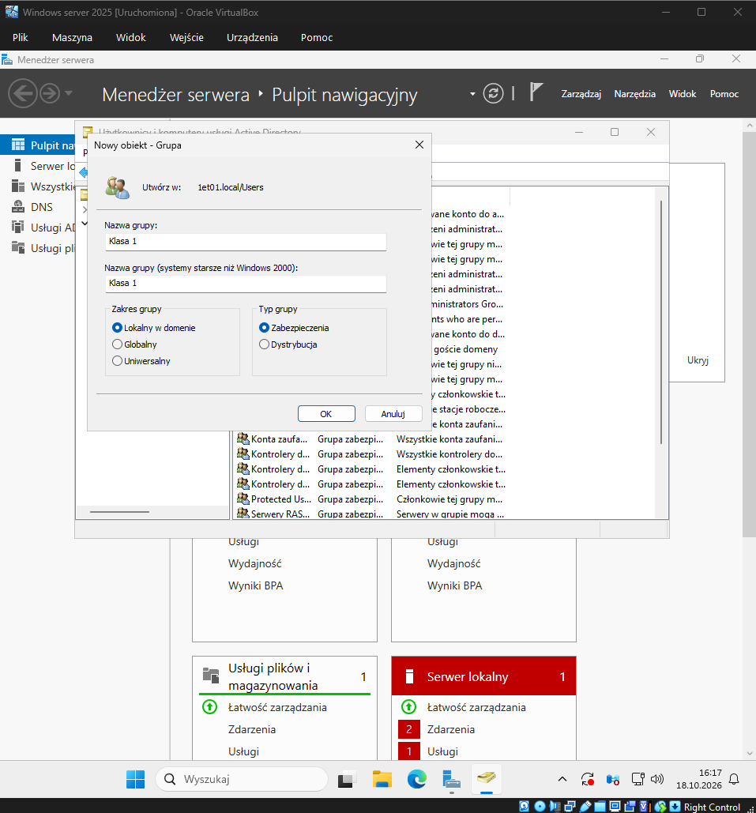
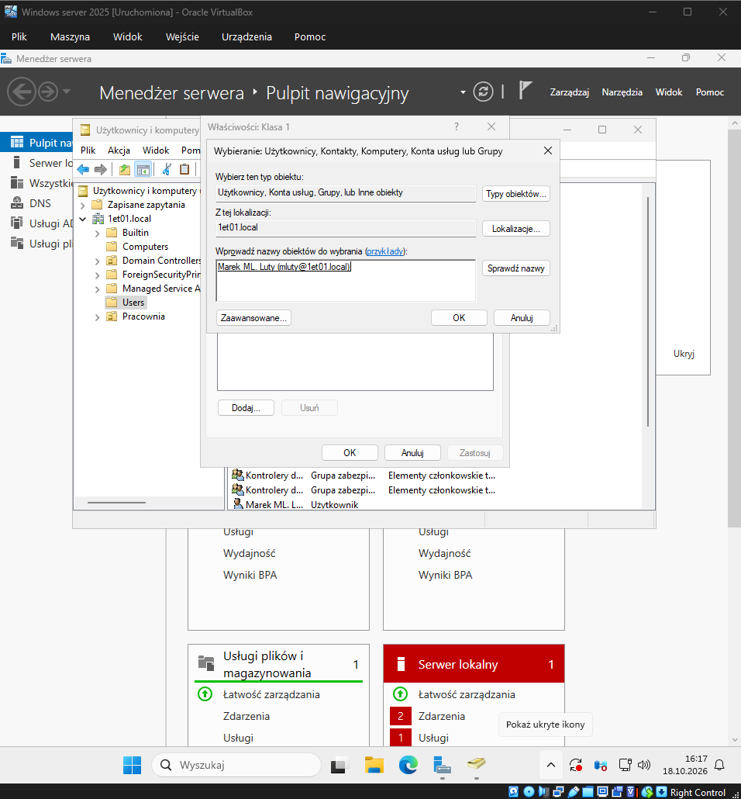

# Temat T11: Grupy użytkowników

## 1. Cel ćwiczenia
* Zrozumienie rodzajów i zakresów działania grup w usłudze Active Directory.
* Tworzenie grup zabezpieczeń oraz zarządzanie ich członkostwem za pomocą interfejsu graficznego (GUI).
* Wykorzystanie programu PowerShell (narzędzi `dsadd`, `dsmod`, `dsrm`, `dsquery`) do zarządzania grupami i użytkownikami.

---

## 2. Pojęcia wstępne

**Definicja grupy:**
Grupa to jednostka administracyjna w Active Directory, służąca do nadawania uprawnień dostępu do zasobów (zamiast przypisywać je pojedynczym użytkownikom) oraz grupowania obiektów.

**Kategorie grup (typy):**
* **Dystrybucyjna** – służy wyłącznie do tworzenia list mailingowych. Nie można przypisać jej uprawnień do zasobów.
* **Zabezpieczeń** – służy do przypisywania uprawnień (posiada również funkcje grupy dystrybucyjnej).

**Rodzaje grup zabezpieczeń (zakresy):**
* **Globalne** – grupują użytkowników i komputery z tej samej domeny. Można nadawać im uprawnienia do zasobów w dowolnej domenie w lesie.
* **Uniwersalne** – mogą zawierać obiekty z dowolnej domeny w lesie i uzyskiwać uprawnienia w dowolnej domenie.
* **Lokalne w domenie** – służą do nadawania uprawnień do konkretnych zasobów w obrębie własnej domeny. Mogą zawierać jako członków inne grupy globalne.

**Dobra praktyka (przykład dostępu do drukarki):**
Zamiast przypisywać 10 użytkowników pojedynczo do drukarki, należy:
1. Utworzyć grupę **Lokalną w domenie** i przypisać jej dostęp do drukarki.
2. Utworzyć grupę **Globalną** i dodać do niej 10 użytkowników.
3. Dodać grupę Globalną jako członka grupy Lokalnej w domenie.

---

## 3. Instrukcja krok po kroku

### Część A: Zarządzanie grupami za pomocą interfejsu graficznego (GUI)

#### Krok 1: Tworzenie grupy zabezpieczeń
1. Z górnego menu **Menedżera serwera** wybierz **Narzędzia** -> **Użytkownicy i komputery usługi Active Directory** (lub uruchom `dsa.msc`).
2. Rozwiń swoją domenę (np. `1et01.local`) i kliknij kontener **Users** prawym przyciskiem myszy. Wybierz **Nowy** -> **Grupa**.
3. W oknie konfiguracji podaj nazwę grupy (np. `Klasa 1`).
4. Wybierz zakres grupy: **Lokalny w domenie** oraz typ grupy: **Zabezpieczenia**.
5. Kliknij **OK**.



#### Krok 2: Dodawanie użytkowników do grupy
1. W kontenerze **Users** kliknij nowo utworzoną grupę (np. `Klasa 1`) prawym przyciskiem myszy i wybierz **Właściwości**.
2. Przejdź do zakładki **Członkowie** i kliknij przycisk **Dodaj...**.
3. W oknie wyboru kliknij **Zaawansowane...**, a następnie **Znajdź teraz**.
4. Z listy wyników na dole wybierz wybranego użytkownika (np. Marka) i zatwierdź **OK**.
5. Użytkownik pojawi się na liście członków grupy. Kliknij **Zastosuj** i **OK**.
6. Sprawdzamy w kontenerze Users, czy nasza grupa została utworzona.
7. Dodamy teraz użytkownika do grupy Klasa 1. Zaznaczamy grupę i prawym przyciskiem myszy wybieramy "Właściwości".
8. Przechodzimy na zakładkę Członkowie. Klikając "Dodaj" możemy uczynić dane obiekty członkami tej grupy.
9. W kolejnym oknie wybieramy przycisk "Zaawansowane".
10. W okienko "Rozpoczyna się od" wpisujemy nazwę użytkownika, którego chcemy dodać do grupy, klikamy "Znajdź teraz". Wybieramy interesujący nas obiekt i klikamy OK.
11. Jeśli wszystko się zgadza klikamy jeszcze raz OK.
12. Zobaczymy, że obiekt Marek Luty został członkiem grupy Klasa 1. Klikamy na "Zastosuj" i "OK".



---

### Część B: Zarządzanie grupami za pomocą PowerShell

Uruchom konsolę **Windows PowerShell** jako administrator (skrót `Win + R` -> `powershell`).

#### Krok 3: Tworzenie i usuwanie grupy (dsadd / dsrm)
Do tworzenia grup służy polecenie `dsadd group`. Przełącznik `-secgrp yes` tworzy grupę zabezpieczeń, a `-scope g` ustala zasięg globalny (`l` - lokalny, `u` - uniwersalny).
1. Utwórz grupę zabezpieczeń `Informatycy` o zasięgu globalnym:
   ```powershell
   dsadd group "CN=Informatycy, CN=Users, DC=1et01, DC=local" -secgrp yes -scope g
   ```
2. Usuń grupę Informatycy za pomocą polecenia dsrm:
   ```powershell
   dsrm "CN=Informatycy, CN=Users, DC=1et01, DC=local"
   ```

#### Krok 4: Zarządzanie członkostwem w grupie (dsmod)
Polecenie dsmod group służy do dodawania (-addmbr) i usuwania (-rmmbr) członków.

1. Dodaj pojedynczego użytkownika do grupy Klasa 1:
```powershell
dsmod group "CN=Klasa 1, CN=Users, DC=1et01, DC=local" -addmbr "CN=Maja Marzec, CN=Users, DC=1et01, DC=local"
```
2. Możesz dodawać wielu użytkowników naraz, stawiając nazwy DN po spacji:
```powershell
dsmod group "CN=Klasa 1, CN=Users, DC=1et01, DC=local" -addmbr "CN=Anna Maj, CN=Users, DC=1et01, DC=local" "CN=Igor Czerwiec, CN=Users, DC=1et01, DC=local"
```
3. Usuń użytkownika z grupy:
```powershell
dsmod group "CN=Klasa 1, CN=Users, DC=1et01, DC=local" -addmbr "CN=Anna Maj, CN=Users, DC=1et01, DC=local" "CN=Igor Czerwiec, CN=Users, DC=1et01, DC=local"
```

#### Krok 5: Wyszukiwanie obiektów (dsquery)

1.
```powershell
dsquery user "CN=Users, DC=1et01, DC=local"
```
2.
```powershell
dsquery user -name *
```
