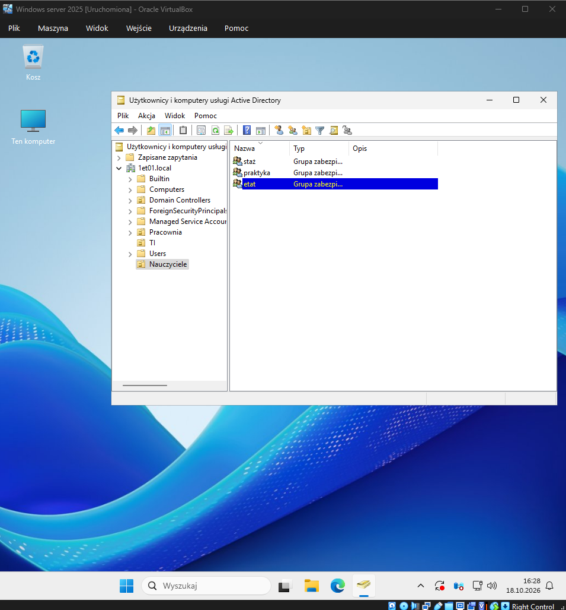

# Temat T12: Prawa użytkowników - nadawanie praw

## 1. Cel ćwiczenia
* Zrozumienie sposobów nadawania uprawnień grupom i użytkownikom.
* Zastosowanie zasady dziedziczenia i łączenia grup w celu łatwiejszego zarządzania uprawnieniami (dodawanie grupy jako członka innej grupy).
* Przypisywanie ról wbudowanych (np. `Użytkownicy`, `Użytkownicy domeny`) do własnych grup zabezpieczeń.

## 2. Środowisko i wymagania wstępne
* Działający kontroler domeny.
* Utworzone w poprzednich ćwiczeniach środowisko w Active Directory (z zainstalowanymi narzędziami i odpowiednimi uprawnieniami administratora).

---

## 3. Instrukcja krok po kroku

### Krok 1: Tworzenie nowej struktury organizacyjnej
Stworzymy nową jednostkę organizacyjną wraz z grupami.
1. Uruchom przystawkę **Użytkownicy i komputery usługi Active Directory** (skrót: `dsa.msc`).
2. Kliknij prawym przyciskiem myszy nazwę domeny (np. `1et01.local`), wybierz **Nowy** -> **Jednostka organizacyjna**.
3. Jako nazwę wpisz `Nauczyciele` i kliknij **OK**.
4. W utworzonej jednostce organizacyjnej *Nauczyciele* utwórz trzy grupy zabezpieczeń o zasięgu globalnym:
   * `staż`
   * `praktyka`
   * `etat`  
   *(Kliknij Prawym Przyciskiem Myszy na Nauczyciele -> Nowy -> Grupa).*

### Krok 2: Nadawanie uprawnień grupom (Zagnieżdżanie grup)
Zamiast nadawać uprawnienia każdemu użytkownikowi z osobna, najefektywniej jest podpiąć stworzoną przez nas grupę (np. `etat`) do innej wbudowanej grupy o konkretnych prawach (np. `Użytkownicy` lub `Użytkownicy domeny`).
1. W jednostce *Nauczyciele* kliknij prawym przyciskiem myszy na grupę **etat** i wybierz **Właściwości**.
2. Przejdź na zakładkę **Członek grupy**. (Zwróć uwagę, by nie pomylić jej z zakładką *Członkowie*!).
3. Kliknij **Dodaj...**.
4. W oknie wyboru wpisz ręcznie `Użytkownicy` i kliknij **Sprawdź nazwy** lub użyj przycisku **Zaawansowane -> Znajdź teraz** i odszukaj na liście **Użytkownicy domeny**.
5. Kliknij **OK**.
6. Na liście *Członek grupy* pojawią się wbudowane grupy zabezpieczeń. Od tej chwili wszyscy użytkownicy należący do grupy `etat` będą automatycznie dziedziczyć uprawnienia z grup `Użytkownicy` / `Użytkownicy domeny`. 
7. Kliknij **Zastosuj** i **OK**.

### Krok 3: Tworzenie konta użytkownika 
1. Kliknij prawym przyciskiem myszy jednostkę **Nauczyciele**, wybierz **Nowy** -> **Użytkownik**.
2. Wpisz dane (np. Imię: `Mikołaj`, Nazwisko: `Kopernik`, logowanie: `mkopernik`). Kliknij **Dalej**.
3. Ustaw bezpieczne hasło (np. `P@ssw0rd`) i wybierz opcję *Użytkownik musi zmienić hasło przy następnym logowaniu*. Kliknij **Zakończ**.

### Krok 4: Dodawanie użytkownika do grupy
Istnieje kilka sposobów na dodanie użytkownika do grupy, najszybszy z nich to:
1. Kliknij utworzonego użytkownika (Mikołaj Kopernik) prawym przyciskiem myszy.
2. Wybierz polecenie **Dodaj do grupy...**
3. W oknie wpisz nazwę grupy `etat` (lub wyszukaj ją używając opcji Zaawansowane -> Znajdź teraz).
4. Kliknij **OK**. Otrzymasz komunikat o pomyślnym dodaniu do grupy.
   *Weryfikacja: Możesz otworzyć Właściwości użytkownika -> zakładka Członek grupy, aby upewnić się, że należy on do grupy etat.*

Zarządzanie uprawnieniami w rozbudowanej domenie staje się znacznie prostsze, gdy zastosujemy mechanizm łączenia grup. Wystarczy dodać węższą grupę (np. „Etat”) do szerszej (np. „Użytkownicy domeny”), aby jej członkowie automatycznie przejęli przypisane tam uprawnienia. W ten sposób budujemy wygodną, kaskadową hierarchię. Należy jednak uważać – taki system nie sprawdzi się w każdej sytuacji i zależy od wewnętrznych ustaleń. Choć każdy błąd w nadawaniu uprawnień można cofnąć, to bez dokładnego rozplanowania struktury już na samym starcie, bardzo łatwo się w niej później pogubić.

Ćwiczenie:
Przypisz grupę etat do grupy Użytkownicy domeny.Przypisz grupę etat do grupy Użytkownicy domeny.
